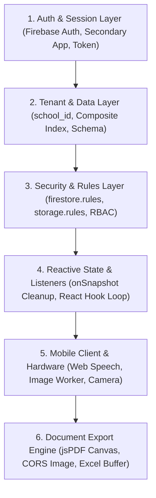

# Semantic System Debugging Runbook (SIMFONI PAUD)

Panduan pemecahan masalah (*troubleshooting*) terstruktur berbasis analisis lapisan semantik sistem untuk mendiagnosis, mengisolasi, dan memperbaiki *bug* di SIMFONI PAUD secara cepat dan tepat sasaran.

---

## 🧭 Peta Lapisan Semantik Sistem (Semantic Layers)

Setiap anomali atau *bug* dalam SIMFONI PAUD dapat diklasifikasikan ke dalam salah satu dari 6 lapisan semantik berikut:



---

## 🔍 Protokol Diagnostik 5 Langkah (5-Step Protocol)

Saat menghadapi error atau perilaku tidak terduga, jalankan protokol berikut secara berurutan:

### Langkah 1: Identifikasi Lapisan Semantik
Tentukan di lapisan mana masalah terjadi berdasarkan pesan error atau gejala visual:
* `permission-denied` / `Missing or insufficient permissions` ➡️ **Lapisan 3 (Security Rules)** atau **Lapisan 2 (Kueri tanpa `school_id`)**
* `The query requires an index` / `failed-precondition` ➡️ **Lapisan 2 (Firestore Composite Index)**
* Pengguna ter-logout sendiri saat membuat user baru ➡️ **Lapisan 1 (Lupa memakai `secondaryAuth`)**
* Suara mic tidak merekam narasi ➡️ **Lapisan 5 (Web Speech API / izin browser)**
* Tab browser mobile *crash* saat klik Cetak ➡️ **Lapisan 6 (Memory spike foto di PDF)**
* Komponen me-render berulang kali (*infinite re-render*) ➡️ **Lapisan 4 (Ketergantungan hook / listener tak di-cleanup)**

---

### Langkah 2: Matriks Masalah & Solusi Cepat per Lapisan

#### 🔴 Lapisan 1: Auth & Sesi Pengguna
| Gejala / Error | Akar Masalah | Solusi Semantik |
| :--- | :--- | :--- |
| Superadmin/Kepsek ter-logout otomatis saat menambah akun baru | `createUserWithEmailAndPassword` dieksekusi pada instance default | Gunakan `secondaryAuth` dari `src/config/firebase.js` lalu segera panggil `signOut(secondaryAuth)`. |
| Pengguna terjebak di modal ganti password | Flag `wajib_ganti_password` di Firestore belum di-set ke `false` setelah update sandi | Pastikan mutasi dokumen `users/{uid}` berhasil mengubah `wajib_ganti_password: false` sesaat setelah `updatePassword()`. |
| Tenant dialihkan paksa ke `/suspended` | Field `status_langganan !== 'aktif'` pada `schoolData` | Periksa dokumen `schools/{school_id}` dan pastikan Superadmin telah mengaktifkan status tenant. |

#### 🟡 Lapisan 2: Tenant & Data Kueri
| Gejala / Error | Akar Masalah | Solusi Semantik |
| :--- | :--- | :--- |
| `The query requires an index. You can create it here: https://...` | Firestore mewajibkan composite index untuk kombinasi `where` majemuk dan `orderBy` | 1. Klik URL di log untuk generate index otomatis di Firebase Console.<br>2. Sebagai mitigasi dev instan: sortir data di memori klien (`list.sort(...)`) daripada di kueri `orderBy`. |
| Data sekolah A muncul di dashboard sekolah B | Kueri kehilangan filter `where("school_id", "==", ...)` | Tambahkan filter `school_id` pada setiap kueri `collection` yang diakses guru atau kepsek. |
| Data offline tidak tersinkronisasi | Duplikasi inisialisasi `enableIndexedDbPersistence` | Pastikan `enableIndexedDbPersistence(db)` hanya dipanggil satu kali saat inisialisasi awal di `firebase.js`. |

#### 🔵 Lapisan 3: Aturan Keamanan (Security Rules)
| Gejala / Error | Akar Masalah | Solusi Semantik |
| :--- | :--- | :--- |
| `FirebaseError: [code=permission-denied]` saat membaca jurnal/presensi | Kueri klien tidak cocok dengan klausa di `firestore.rules` (misal kueri meminta seluruh sekolah) | Samakan filter kueri dengan aturan security: Kueri **harus** secara eksplisit memfilter `school_id` yang sesuai dengan token auth pengguna. |
| Gagal upload foto dokumentasi ke Storage | Path file tidak sesuai dengan pola aturan `storage.rules` | Pastikan path file mengikuti standar: `schools/{schoolId}/{folder}/{userId}/{filename}`. |

#### 🟢 Lapisan 4: State Reaktif & Listener
| Gejala / Error | Akar Masalah | Solusi Semantik |
| :--- | :--- | :--- |
| Konsumsi kuota baca Firestore melonjak tinggi | Listener `onSnapshot` tidak di-unsubscribe saat komponen unmount | Selalu kembalikan fungsi pembersih pada `useEffect`: <br>`useEffect(() => { const unsub = onSnapshot(...); return () => unsub(); }, [deps]);` |
| `Warning: Maximum update depth exceeded` | State setter dipanggil di dalam render body tanpa kondisi penghenti | Pindahkan mutasi ke event handler atau tambahkan guard check pada nilai state sebelum memanggil setter. |

#### 🟣 Lapisan 5: Klien Mobile & Hardware Smartphone
| Gejala / Error | Akar Masalah | Solusi Semantik |
| :--- | :--- | :--- |
| `Speech recognition error: not-allowed` | Browser memblokir izin mikrofon atau berjalan di insecure HTTP | Web Speech API mewajibkan koneksi HTTPS (atau `localhost`). Berikan instruksi UI bagi guru untuk membuka gembok izin di bar URL. |
| Upload kamera HP gagal / memori habis | Browser kehabisan memori akibat gambar 48MP | Library `browser-image-compression` wajib mengaktifkan opsi `useWebWorker: true` dan membatasi `maxWidthOrHeight: 1280`. |
| Guru tercatat terlambat padahal hadir tepat waktu saat offline | Hanya mengandalkan jam server yang baru masuk saat sinyal pulih | Gunakan semantik Dual Timestamp: baca `jam_datang_device` yang dicatat saat tombol absen ditekan secara offline. |

#### 🟠 Lapisan 6: Engine Ekspor Dokumen
| Gejala / Error | Akar Masalah | Solusi Semantik |
| :--- | :--- | :--- |
| `SecurityError: The operation is insecure (Tainted canvas)` | Logo sekolah dari URL eksternal memblokir pembacaan canvas pada jsPDF | Pastikan gambar di-load dengan atribut `crossOrigin = "Anonymous"` atau konversi ke base64 via helper internal. |
| Hasil download PDF corrupt atau kosong | jsPDF dipanggil sebelum seluruh aset gambar selesai dimuat | Gunakan `Promise.all` untuk menunggu pemuatan `Image()` selesai sebelum menggambar ke canvas atau dokumen PDF. |

---

## 🛠️ Perintah & Script Diagnostik Cepat

### 1. Verifikasi Build & Syntax Linting
```powershell
# Uji apakah terdapat syntax error atau missing imports
& "C:\Program Files\nodejs\npm.cmd" run build
```

### 2. Pengecekan Kueri Firestore Tanpa `school_id`
Gunakan pola pencarian regex berikut di codebase untuk mendeteksi potensi kebocoran tenant:
* Pola berisiko: `query(collection(db,` yang tidak diikuti baris `where('school_id',`

---

## 📋 Checklist Verifikasi Pasca-Perbaikan (Post-Fix Verification)
- [ ] Apakah kueri data operasional tetap menyertakan `school_id`?
- [ ] Apakah seluruh listener Firestore (`onSnapshot`) memiliki cleanup callback?
- [ ] Apakah penambahan/mutasi akun tetap menggunakan `secondaryAuth`?
- [ ] Apakah hasil `npm run build` berhasil tanpa error?
- [ ] Dilarang auto-commit/push tanpa persetujuan Pengguna!

