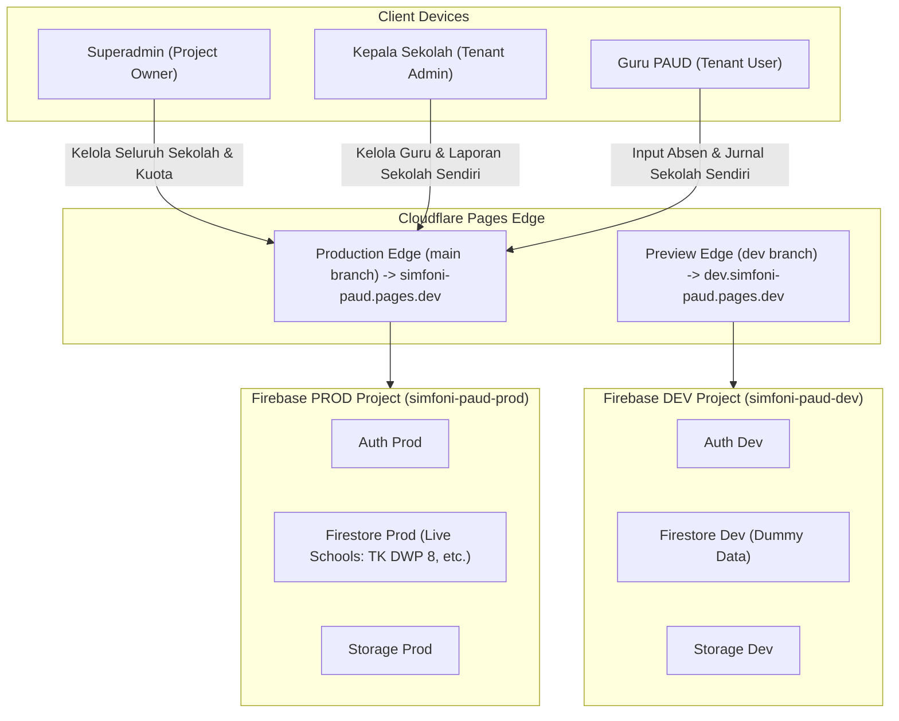

# 🏛️ Arsitektur Sistem: SIMFONI PAUD (SaaS Multi-Tenant Edition)

Dokumen ini menjelaskan arsitektur teknis, topologi multi-tenant, lingkungan Dev vs Prod, integrasi layanan Firebase, dan struktur folder untuk platform **SIMFONI PAUD (SaaS Edition)**.

---

## 1. Topologi Multi-Tenant & Desain Sistem

SIMFONI PAUD menggunakan pendekatan arsitektur **Shared Database, Shared Schema dengan Tenant Identifier (`school_id`)**:
* Seluruh sekolah mitra bernaung dalam satu proyek Firestore yang sama.
* Setiap dokumen operasional (`attendance`, `journals`, `schedules`, `tasks_and_issues`, `audit_logs`) dan dokumen pengguna (`users`) diberi label `school_id`.
* Isolasi data ditegakkan di tingkat backend oleh **Firestore Security Rules** dan di tingkat UI melalui *scoped state* pada `AuthContext`.



---

## 2. Hierarki 3 Peran Pengguna (3-Tier RBAC)

```mermaid
flowchart TD
    SA["👑 superadmin (Project Owner)<br/>school_id: null | Global Master Access"]
    KP["🏫 kepsek (School Tenant Admin)<br/>school_id: 'sch_xxxx' | Dibatasi Kuota Guru"]
    GR["👩‍🏫 guru (School Tenant User)<br/>school_id: 'sch_xxxx' | Operasional Harian KBM"]

    SA -->|Membuat Sekolah & Akun Kepsek| KP
    KP -->|Mendaftarkan Akun Guru (Maks = kuota_guru)| GR
```

1. **`superadmin` (Project Owner):**
   * Mengelola mitra sekolah (tambah, edit profil/kop surat/logo, suspend langganan, atur kuota guru).
   * Mendaftarkan akun Kepala Sekolah baru via *Secondary Auth Instance*.
   * Memantau analitik performa global SaaS.
2. **`kepsek` (Kepala Sekolah / Tenant Admin):**
   * Terikat pada satu `school_id`.
   * Mengelola akun guru di sekolahnya sesuai batas `kuota_guru`.
   * Memvalidasi jurnal KBM, menyetujui koreksi absen, mengatur jadwal, dan mengunduh rekap PDF resmi sekolahnya.
3. **`guru` (Pengajar / Tenant User):**
   * Terikat pada satu `school_id`.
   * Melakukan presensi, mengisi jurnal mengajar dengan Voice-to-Text, mengunggah foto kompresi, dan menyampaikan kendala.

---

## 3. Pola Kunci: Firebase Dual-App Instance (Secondary Auth)

Firebase Auth Client SDK secara default me-*logout* akun aktif saat fungsi `createUserWithEmailAndPassword()` dipanggil.
Dalam arsitektur SaaS SIMFONI PAUD, terdapat dua tingkatan pendaftaran akun:
1. `superadmin` mendaftarkan `kepsek` baru.
2. `kepsek` mendaftarkan `guru` baru.

Keduanya wajib menggunakan **Secondary Firebase App Instance** (`secondaryAuth`) agar sesi pengguna aktif tidak terputus:

```javascript
// src/config/firebase.js
import { initializeApp } from "firebase/app";
import { getAuth, createUserWithEmailAndPassword, signOut } from "firebase/auth";
import { getFirestore, doc, setDoc, serverTimestamp, enableIndexedDbPersistence } from "firebase/firestore";
import { getStorage } from "firebase/storage";

const firebaseConfig = {
  apiKey: import.meta.env.VITE_FIREBASE_API_KEY,
  authDomain: import.meta.env.VITE_FIREBASE_AUTH_DOMAIN,
  projectId: import.meta.env.VITE_FIREBASE_PROJECT_ID,
  storageBucket: import.meta.env.VITE_FIREBASE_STORAGE_BUCKET,
  messagingSenderId: import.meta.env.VITE_FIREBASE_MESSAGING_SENDER_ID,
  appId: import.meta.env.VITE_FIREBASE_APP_ID,
};

// 1. Primary App (Untuk sesi aktif pengguna)
export const app = initializeApp(firebaseConfig);
export const auth = getAuth(app);
export const db = getFirestore(app);
export const storage = getStorage(app);

// Aktifkan Offline Persistence
enableIndexedDbPersistence(db).catch((err) => {
  console.warn("Firestore offline persistence unavailable:", err.code);
});

// 2. Secondary App (Khusus pendaftaran user baru tanpa me-logout admin aktif)
const secondaryApp = initializeApp(firebaseConfig, "SecondaryApp");
export const secondaryAuth = getAuth(secondaryApp);

/**
 * Superadmin mendaftarkan Kepala Sekolah baru
 */
export const createKepsekAccountBySuperadmin = async (email, password, nama, schoolId, namaSekolah) => {
  const credential = await createUserWithEmailAndPassword(secondaryAuth, email, password);
  const newUid = credential.user.uid;

  await setDoc(doc(db, "users", newUid), {
    uid: newUid,
    nama,
    email,
    role: "kepsek",
    school_id: schoolId,
    nama_sekolah: namaSekolah,
    status_akun: "aktif",
    created_at: serverTimestamp(),
    updated_at: serverTimestamp(),
  });

  await signOut(secondaryAuth);
  return newUid;
};

/**
 * Kepala Sekolah mendaftarkan Guru baru (dengan validasi kuota)
 */
export const createGuruAccountByKepsek = async (email, password, nama, schoolId, namaSekolah, kelompokKelas) => {
  const credential = await createUserWithEmailAndPassword(secondaryAuth, email, password);
  const newUid = credential.user.uid;

  await setDoc(doc(db, "users", newUid), {
    uid: newUid,
    nama,
    email,
    role: "guru",
    school_id: schoolId,
    nama_sekolah: namaSekolah,
    kelompok_kelas: kelompokKelas,
    status_akun: "aktif",
    created_at: serverTimestamp(),
    updated_at: serverTimestamp(),
  });

  await signOut(secondaryAuth);
  return newUid;
};
```

---

## 4. Pemisahan Lingkungan: DEV vs PROD

Untuk menjaga kebersihan data sekolah mitra produksi, arsitektur memisahkan dua siklus lingkungan secara mutlak:

| Aspek | Lingkungan Development (Uji Coba) 🟡 | Lingkungan Production (SaaS Live) 🟢 |
| :--- | :--- | :--- |
| **Branch Git** | `dev` | `main` |
| **Firebase Project** | `simfoni-paud-dev` | `simfoni-paud-prod` |
| **Domain Cloudflare** | `https://dev.simfoni-paud.pages.dev` | `https://simfoni-paud.pages.dev` |
| **Database State** | Data dummy sekolah uji coba | Data sekolah riil (TK DWP 8, dll.) |
| **Badge UI** | Tampil badge mengambang `DEV ENVIRONMENT` | Badge disembunyikan otomatis |

---

## 5. Struktur Direktori Proyek

```text
simfoni-paud/
├── public/
│   ├── _redirects               # SPA routing Cloudflare: /* /index.html 200
│   ├── manifest.json            # PWA Web App Manifest
│   └── icons/                   # Ikon PWA (192px, 512px)
├── src/
│   ├── config/
│   │   └── firebase.js          # Primary & Secondary Firebase App Instances
│   ├── context/
│   │   └── AuthContext.jsx      # Auth state, role checking, schoolData loader, suspend detector
│   ├── hooks/
│   │   ├── useSpeechToText.js   # Voice-to-Text bahasa Indonesia via Web Speech API
│   │   └── useFirestore.js      # Scoped Firestore listener dengan filter school_id otomatis
│   ├── utils/
│   │   ├── imageCompressor.js   # Kompresi gambar client-side (<300KB)
│   │   ├── pdfExporter.js       # Generator PDF Dinamis (Kop Surat & Nama Kepsek dari schoolData)
│   │   ├── excelExporter.js     # Ekspor rekapitulasi kehadiran ke Excel (.xlsx) untuk honor guru
│   │   ├── auditLogger.js       # Helper logging aktivitas penting per school_id
│   │   └── formatters.js        # Format tanggal WIB & string utilities
│   ├── components/
│   │   ├── layout/
│   │   │   ├── AppLayout.jsx    # Layout adaptif: BottomNav di HP, Sidebar di Laptop
│   │   │   ├── Header.jsx       # Header identitas dinamis: Logo & Nama Sekolah dari context
│   │   │   ├── BottomNav.jsx    # Bottom navigation mobile
│   │   │   ├── Sidebar.jsx      # Sidebar desktop dengan navigasi per role
│   │   │   ├── DevBadge.jsx     # Floating badge DEV ENVIRONMENT jika bukan mode production
│   │   │   └── ProtectedRoute.jsx # Pelindung rute berdasarkan role (superadmin, kepsek, guru)
│   │   └── ui/                  # Komponen UI (Modal, Button, Badge, Alert, Card)
│   ├── pages/
│   │   ├── auth/
│   │   │   ├── Login.jsx        # Halaman Login + Flow Initial Seeding Superadmin & Pilot School
│   │   │   └── SuspendedSchool.jsx # Layanan diblokir jika status_langganan == 'nonaktif'
│   │   ├── superadmin/
│   │   │   ├── DashboardSuperadmin.jsx # Ringkasan metrik SaaS global & statistik sekolah
│   │   │   ├── KelolaSekolah.jsx       # CRUD Sekolah Mitra, atur kuota guru & paket langganan
│   │   │   └── KelolaAkunKepsek.jsx    # Pembuatan & manajemen akun Kepala Sekolah
│   │   ├── guru/
│   │   │   ├── DashboardGuru.jsx       # Absen datang/pulang cepat & status jurnal hari ini
│   │   │   ├── PresensiGuru.jsx        # Riwayat presensi & form koreksi
│   │   │   ├── JurnalGuru.jsx          # KBM Form, Draf, Voice-to-Text, Foto, Duplikasi
│   │   │   ├── JadwalGuru.jsx          # Jadwal mengajar mingguan kelas
│   │   │   └── LaporanLainGuru.jsx     # Tugas tambahan, administrasi & kendala KBM
│   │   └── kepsek/
│   │       ├── DashboardKepsek.jsx     # Monitoring live presensi & jurnal sekolah
│   │       ├── KelolaGuru.jsx          # CRUD Akun Guru (dengan validasi batas kuota_guru)
│   │       ├── ValidasiLaporan.jsx     # Persetujuan & revisi jurnal KBM serta koreksi absen
│   │       ├── KelolaJadwal.jsx        # Penataan jadwal kelas TK A & TK B
│   │       └── RekapDanPdf.jsx         # Rekapitulasi & ekspor PDF kop surat dinamis
│   ├── App.jsx                  # Router deklaratif dengan segmentasi rute 3 role
│   ├── index.css                # Base Tailwind CSS styles
│   └── main.jsx                 # Entrypoint React
├── docs/                        # Dokumentasi teknis modular
├── AGENTS.md                    # Master Blueprint AI Agent & Kebijakan Sinkronisasi Dokumen
├── .env.example                 # Template variabel lingkungan
├── .gitignore                   # Proteksi kredensial .env.local, .env.development, dist, dll.
├── firestore.rules              # Aturan keamanan multi-tenant Cloud Firestore
├── storage.rules                # Aturan isolasi direktori Firebase Storage per sekolah
├── package.json
├── tailwind.config.js
└── vite.config.js
```
