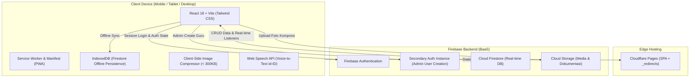

# 🏛️ Arsitektur Sistem: SIMFONI PAUD

Dokumen ini menjelaskan arsitektur teknis, topologi sistem, integrasi layanan, dan struktur folder untuk aplikasi **SIMFONI PAUD (Sistem Informasi Monitoring dan Pelaporan Terintegrasi PAUD)** di **TK Dharma Wanita Persatuan 8**.

---

## 1. Topologi & Desain Sistem

SIMFONI PAUD dirancang dengan arsitektur **Mobile-First Progressive Web App (PWA)** berbasis Single Page Application (SPA) yang dihosting di jaringan edge global, berkomunikasi langsung dengan Backend-as-a-Service (BaaS) Firebase.



---

## 2. Tech Stack Utama

| Layer | Teknologi | Catatan Penggunaan |
| :--- | :--- | :--- |
| **Framework UI** | React 18+ | Library inti untuk antarmuka pengguna berbasis komponen deklaratif. |
| **Build Tool** | Vite | Bundler modern berkecepatan tinggi dengan Hot Module Replacement (HMR). |
| **Styling** | Tailwind CSS | Utility-first CSS untuk desain mobile-first responsif. |
| **Icon Library** | `lucide-react` | Kumpulan ikon ringan, konsisten, dan fleksibel. |
| **Routing** | `react-router-dom` v6 | Manajemen navigasi client-side SPA dengan protected routes per role. |
| **Backend & Auth** | Firebase v10+ Modular SDK | Auth, Firestore, dan Storage tanpa server custom. |
| **Kompresi Gambar** | `browser-image-compression` | Mereduksi foto 3-10 MB dari HP menjadi < 300 KB sebelum upload. |
| **Export PDF** | `jspdf` & `jspdf-autotable` | Membuat dokumen laporan resmi berformat PDF lengkap dengan Kop Surat. |
| **Manipulasi Waktu** | `date-fns` | Format tanggal Bahasa Indonesia dan penanganan zona waktu lokal (WIB). |
| **Hosting** | Cloudflare Pages | Hosting static assets global cepat dan gratis dengan routing SPA. |

---

## 3. Pola Kunci: Firebase Dual-App Instance

### Latar Belakang Masalah
Pada Firebase Authentication Client SDK, memanggil `createUserWithEmailAndPassword()` pada instance default akan secara otomatis mengubah sesi aktif pengguna yang sedang login menjadi pengguna baru tersebut. Jika Kepala Sekolah sedang login dan membuat akun guru baru, Kepala Sekolah akan langsung ter-*logout*.

### Solusi Arsitektural
Sistem menginisialisasi **Secondary Firebase App Instance** terpisah khusus untuk operasi pembuatan akun oleh Kepala Sekolah.

```javascript
// src/config/firebase.js
import { initializeApp } from "firebase/app";
import { getAuth, createUserWithEmailAndPassword, signOut } from "firebase/auth";
import { getFirestore, doc, setDoc, serverTimestamp, enableIndexedDbPersistence } from "firebase/firestore";
import { getStorage } from "firebase/storage";

const firebaseConfig = {
  apiKey: import.meta.env.VITE_FIREBASE_API_KEY,
  authDomain: import.meta.env.VITE_FIREBASE_AUTH_DOMAIN,
  projectId: import.meta.env.VITE_FIREBASE_PROJECT_ID,
  storageBucket: import.meta.env.VITE_FIREBASE_STORAGE_BUCKET,
  messagingSenderId: import.meta.env.VITE_FIREBASE_MESSAGING_SENDER_ID,
  appId: import.meta.env.VITE_FIREBASE_APP_ID,
};

// 1. Primary App (Untuk sesi aktif pengguna)
export const app = initializeApp(firebaseConfig);
export const auth = getAuth(app);
export const db = getFirestore(app);
export const storage = getStorage(app);

// Aktifkan Offline Persistence agar draf jurnal tetap tersimpan di lokal
enableIndexedDbPersistence(db).catch((err) => {
  console.warn("Firestore offline persistence unavailable:", err.code);
});

// 2. Secondary App (Khusus pendaftaran guru baru oleh Kepala Sekolah)
const secondaryApp = initializeApp(firebaseConfig, "SecondaryApp");
export const secondaryAuth = getAuth(secondaryApp);

/**
 * Membuat akun guru baru tanpa me-logout sesi Kepala Sekolah
 */
export const createGuruAccountByAdmin = async (email, password, nama, kelompokKelas) => {
  const userCredential = await createUserWithEmailAndPassword(secondaryAuth, email, password);
  const newUid = userCredential.user.uid;

  await setDoc(doc(db, "users", newUid), {
    uid: newUid,
    nama: nama,
    email: email,
    role: "guru",
    kelompok_kelas: kelompokKelas,
    status_akun: "aktif",
    created_at: serverTimestamp(),
    updated_at: serverTimestamp()
  });

  // Segera sign out dari secondary instance agar tidak meninggalkan credential
  await signOut(secondaryAuth);
  return newUid;
};
```

---

## 4. Strategi Offline & Keandalan Sinyal (Offline Persistence)

Aplikasi ditargetkan untuk lingkungan sekolah di mana konektivitas internet guru terkadang fluktuatif:
1. **Firestore IndexedDb Persistence**: Memungkinkan pembacaan cache lokal dan pengantrian penulisan draf jurnal saat jaringan terputus.
2. **PWA Service Worker & App Manifest**: Memungkinkan aplikasi dipasang di homescreen smartphone guru dan memuat shell aplikasi secara instan.
3. **Local Draft Auto-save**: Formulir jurnal menyediakan status `draf` yang disimpan secara teratur untuk mencegah kehilangan data jika aplikasi tertutup tiba-tiba.

---

## 5. Struktur Direktori Proyek

```text
simfoni-paud/
├── public/
│   ├── _redirects               # Wajib untuk routing SPA di Cloudflare Pages (/* /index.html 200)
│   ├── manifest.json            # Konfigurasi PWA Mobile Homescreen
│   └── icons/                   # Ikon aplikasi PWA (192px, 512px)
├── src/
│   ├── config/
│   │   └── firebase.js          # Konfigurasi Primary & Secondary Firebase App
│   ├── context/
│   │   └── AuthContext.jsx      # Context auth, sinkronisasi role & status user aktif
│   ├── hooks/
│   │   ├── useSpeechToText.js   # Voice-to-Text bahasa Indonesia via Web Speech API
│   │   └── useFirestore.js      # Reusable listener / data query hooks
│   ├── utils/
│   │   ├── imageCompressor.js   # Kompresi gambar client-side (<300KB)
│   │   ├── pdfExporter.js       # Generator PDF Rekap Resmi dengan Kop Surat
│   │   ├── auditLogger.js       # Helper logging aktivitas penting ke audit_logs
│   │   └── formatters.js        # Format tanggal (WIB) & string helper
│   ├── components/
│   │   ├── layout/
│   │   │   ├── AppLayout.jsx    # Layout adaptif: BottomNav (<768px) & Sidebar (>=768px)
│   │   │   ├── Header.jsx       # Header identitas TK DWP 8 & Profil Pengguna
│   │   │   ├── BottomNav.jsx    # Navigasi bawah ramah jempol untuk layar mobile
│   │   │   ├── Sidebar.jsx      # Navigasi samping untuk desktop/laptop
│   │   │   └── ProtectedRoute.jsx # Pelindung rute berdasarkan status login & role
│   │   └── ui/                  # Komponen UI atomik & reusable (Modal, Button, Badge, Alert)
│   ├── pages/
│   │   ├── auth/
│   │   │   └── Login.jsx        # Halaman Login + Flow Initial Setup Akun Kepsek Pertama
│   │   ├── guru/
│   │   │   ├── DashboardGuru.jsx   # Quick action: Absen Datang/Pulang & Jurnal Hari Ini
│   │   │   ├── PresensiGuru.jsx    # Riwayat absen & form pengajuan koreksi
│   │   │   ├── JurnalGuru.jsx      # List, Form, Upload Foto, STT, Duplikasi Jurnal
│   │   │   ├── JadwalGuru.jsx      # Tampilan jadwal mengajar mingguan
│   │   │   └── LaporanLainGuru.jsx # Tugas tambahan, administrasi, dan laporan kendala
│   │   └── kepsek/
│   │       ├── DashboardKepsek.jsx # Monitoring real-time seluruh aktivitas guru
│   │       ├── KelolaGuru.jsx      # CRUD Akun Guru (Add, Edit, Soft-Delete/Nonaktif)
│   │       ├── ValidasiLaporan.jsx # Verifikasi jurnal, koreksi presensi & kendala
│   │       ├── KelolaJadwal.jsx    # Penataan jadwal mengajar mingguan
│   │       └── RekapDanPdf.jsx     # Filter rekapitulasi, cetak PDF resmi, audit log
│   ├── App.jsx                  # Konfigurasi router aplikasi
│   ├── index.css                # Tailwind base styles
│   └── main.jsx                 # Entry point React
├── docs/                        # Dokumentasi terfragmentasi & aturan detail
├── AGENTS.md                    # Panduan utama eksekusi AI Agent & sync policy
├── .env.example                 # Template variabel lingkungan Firebase
├── firestore.rules              # Aturan keamanan database Cloud Firestore
├── storage.rules                # Aturan keamanan media Firebase Storage
├── package.json
├── tailwind.config.js
└── vite.config.js
```

