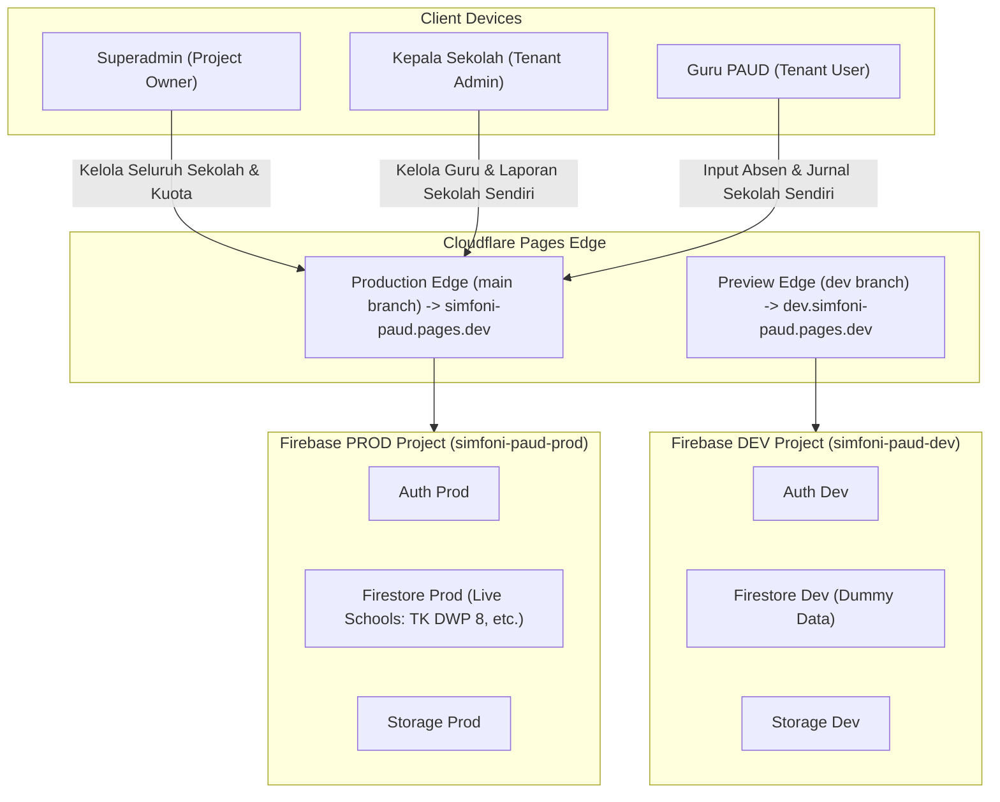

# 🏛️ Arsitektur Sistem: SIMFONI PAUD (SaaS Multi-Tenant Edition)

Dokumen ini menjelaskan arsitektur teknis, topologi multi-tenant, lingkungan Dev vs Prod, integrasi layanan Firebase, dan struktur folder untuk platform **SIMFONI PAUD (SaaS Edition)**.

---

## 1. Topologi Multi-Tenant & Desain Sistem

SIMFONI PAUD menggunakan pendekatan arsitektur **Shared Database, Shared Schema dengan Tenant Identifier (`school_id`)**:
* Seluruh sekolah mitra bernaung dalam satu proyek Firestore yang sama.
* Setiap dokumen operasional (`attendance`, `journals`, `schedules`, `tasks_and_issues`, `audit_logs`) dan dokumen pengguna (`users`) diberi label `school_id`.
* Isolasi data ditegakkan di tingkat backend oleh **Firestore Security Rules** dan di tingkat UI melalui *scoped state* pada `AuthContext`.



---

## 2. Hierarki 3 Peran Pengguna (3-Tier RBAC)

```mermaid
flowchart TD
    SA["👑 superadmin (Project Owner)<br/>school_id: null | Global Master Access"]
    KP["🏫 kepsek (School Tenant Admin)<br/>school_id: 'sch_xxxx' | Dibatasi Kuota Guru"]
    GR["👩‍🏫 guru (School Tenant User)<br/>school_id: 'sch_xxxx' | Operasional Harian KBM"]

    SA -->|Membuat Sekolah & Akun Kepsek| KP
    KP -->|Mendaftarkan Akun Guru (Maks = kuota_guru)| GR
```

1. **`superadmin` (Project Owner):**
   * Mengelola mitra sekolah (tambah, edit profil/kop surat/logo, suspend langganan, atur kuota guru).
   * Mendaftarkan akun Kepala Sekolah baru via *Secondary Auth Instance*.
   * Memantau analitik performa global SaaS.
2. **`kepsek` (Kepala Sekolah / Tenant Admin):**
   * Terikat pada satu `school_id`.
   * Mengelola akun guru di sekolahnya sesuai batas `kuota_guru`.
   * Memvalidasi jurnal KBM, menyetujui koreksi absen, mengatur jadwal, dan mengunduh rekap PDF resmi sekolahnya.
3. **`guru` (Pengajar / Tenant User):**
   * Terikat pada satu `school_id`.
   * Melakukan presensi, mengisi jurnal mengajar dengan Voice-to-Text, mengunggah foto kompresi, dan menyampaikan kendala.

---

## 3. Pola Kunci: Firebase Dual-App Instance (Secondary Auth)

Firebase Auth Client SDK secara default me-*logout* akun aktif saat fungsi `createUserWithEmailAndPassword()` dipanggil.
Dalam arsitektur SaaS SIMFONI PAUD, terdapat dua tingkatan pendaftaran akun:
1. `superadmin` mendaftarkan `kepsek` baru.
2. `kepsek` mendaftarkan `guru` baru.

Keduanya wajib menggunakan **Secondary Firebase App Instance** (`secondaryAuth`) agar sesi pengguna aktif tidak terputus:

```javascript
// src/config/firebase.js
import { initializeApp } from "firebase/app";
import { getAuth, createUserWithEmailAndPassword, signOut } from "firebase/auth";
import {
  initializeFirestore, persistentLocalCache, persistentMultipleTabManager,
  doc, setDoc, serverTimestamp,
} from "firebase/firestore";
import { getStorage } from "firebase/storage";

const firebaseConfig = {
  apiKey: import.meta.env.VITE_FIREBASE_API_KEY,
  authDomain: import.meta.env.VITE_FIREBASE_AUTH_DOMAIN,
  projectId: import.meta.env.VITE_FIREBASE_PROJECT_ID,
  storageBucket: import.meta.env.VITE_FIREBASE_STORAGE_BUCKET,
  messagingSenderId: import.meta.env.VITE_FIREBASE_MESSAGING_SENDER_ID,
  appId: import.meta.env.VITE_FIREBASE_APP_ID,
};

// 1. Primary App (Untuk sesi aktif pengguna)
export const app = initializeApp(firebaseConfig);
export const auth = getAuth(app);
// Offline Persistence (IndexedDB) dengan multi-tab manager: tetap aktif walau aplikasi
// dibuka di beberapa tab (API lama enableIndexedDbPersistence gagal pada kondisi ini).
export const db = initializeFirestore(app, {
  localCache: persistentLocalCache({ tabManager: persistentMultipleTabManager() }),
});
export const storage = getStorage(app);

// Opsional: VITE_USE_FIREBASE_EMULATOR=true menghubungkan Auth/Firestore/Storage ke
// Firebase Local Emulator Suite untuk uji lokal tanpa menyentuh data project.

// 2. Secondary App (Khusus pendaftaran user baru tanpa me-logout admin aktif)
const secondaryApp = initializeApp(firebaseConfig, "SecondaryApp");
export const secondaryAuth = getAuth(secondaryApp);

/**
 * Superadmin mendaftarkan Kepala Sekolah baru
 */
export const createKepsekAccountBySuperadmin = async (email, password, nama, schoolId, namaSekolah) => {
  const credential = await createUserWithEmailAndPassword(secondaryAuth, email, password);
  const newUid = credential.user.uid;

  await setDoc(doc(db, "users", newUid), {
    uid: newUid,
    nama,
    email,
    role: "kepsek",
    school_id: schoolId,
    nama_sekolah: namaSekolah,
    status_akun: "aktif",
    created_at: serverTimestamp(),
    updated_at: serverTimestamp(),
  });

  await signOut(secondaryAuth);
  return newUid;
};

/**
 * Kepala Sekolah mendaftarkan Guru baru (dengan validasi kuota)
 */
export const createGuruAccountByKepsek = async (email, password, nama, schoolId, namaSekolah, kelompokKelas) => {
  const credential = await createUserWithEmailAndPassword(secondaryAuth, email, password);
  const newUid = credential.user.uid;

  await setDoc(doc(db, "users", newUid), {
    uid: newUid,
    nama,
    email,
    role: "guru",
    school_id: schoolId,
    nama_sekolah: namaSekolah,
    kelompok_kelas: kelompokKelas,
    status_akun: "aktif",
    created_at: serverTimestamp(),
    updated_at: serverTimestamp(),
  });

  await signOut(secondaryAuth);
  return newUid;
};
```

---

### 3.1. Penulisan Ramah Offline (`commitWrite`)
Dengan offline persistence, promise `setDoc/updateDoc` baru selesai saat server mengonfirmasi. Agar tombol absen/kirim jurnal tidak berputar selamanya di sinyal lemah, seluruh penulisan operasional guru dibungkus `commitWrite()` dari `src/utils/offlineWrite.js`: bila perangkat offline atau server belum menjawab dalam 4 detik, UI menampilkan *"tersimpan di HP, otomatis terkirim saat sinyal kembali"*. ID dokumen baru dibuat di klien (`doc(collection(...))`) karena `addDoc` menunggu server. `logActivity()` bersifat *fire-and-forget*.

### 3.2. API Admin Tanpa Email (Cloudflare Worker)
Firebase client SDK tidak dapat mengganti sandi pengguna lain. Fitur **Reset Password ke Default** diproses oleh Worker `worker/index.js` pada rute `POST /api/admin/reset-password`:
1. Memverifikasi Firebase ID Token pemanggil (RS256, kunci publik Google, `aud`/`iss` = project).
2. Membaca dokumen `users` pemanggil & target via Firestore REST memakai Service Account.
3. Otorisasi di server: Superadmin → Kepsek/Guru mana pun; Kepsek → hanya Guru di `school_id` yang sama.
4. Mengganti sandi via Identity Toolkit `accounts:update` ke default sesuai peran target (`Guru1234!` / `Kepsek1234!`) dan menandai `wajib_ganti_password: true`.

Bila Worker belum dikonfigurasi (mis. `npm run dev`), klien (`src/utils/adminApi.js`) otomatis jatuh ke alternatif: kirim tautan reset ke email + tandai wajib ganti sandi, dan memberi tahu pengguna secara jujur.

### 3.2a. Penegakan Kuota Guru di Server (Counter + Batch)
`createGuruAccountByKepsek` dan `toggleStatusGuruByKepsek` menulis dokumen guru **dan** `schools.jumlah_guru_aktif` (`increment(±1)`, `counter_ref_uid`) dalam satu `writeBatch`. Security Rules memverifikasi selisih status guru dengan `get()`/`getAfter()` dan menolak bila melebihi `kuota_guru` — tanpa Cloud Functions. `src/utils/quotaSync.js` menyelaraskan counter otomatis saat Superadmin membuka Dashboard/Kelola Sekolah.

### 3.3. Konfigurasi Operasional Sekolah (`schoolConfig.js`)
Jam masuk/pulang, toleransi keterlambatan, hari kerja, dan daftar kelompok kelas dibaca dari dokumen `schools` melalui helper `src/utils/schoolConfig.js` (dengan nilai bawaan). Seluruh perhitungan status `terlambat`, menit keterlambatan, dan hari kerja efektif rekap memakai helper ini. Label kelompok lama (`Kelompok Bermain (KB)`, `Semua Kelompok`) dinormalisasi agar relasi jadwal ↔ jurnal ↔ guru konsisten.

---

## 4. Pemisahan Lingkungan: DEV vs PROD

Untuk menjaga kebersihan data sekolah mitra produksi, arsitektur memisahkan dua siklus lingkungan secara mutlak:

| Aspek | Lingkungan Development (Uji Coba) 🟡 | Lingkungan Production (SaaS Live) 🟢 |
| :--- | :--- | :--- |
| **Branch Git** | `dev` | `main` |
| **Firebase Project** | `simfoni-paud-dev` | `simfoni-paud-prod` |
| **Domain Cloudflare** | `https://dev.simfoni-paud.pages.dev` | `https://simfoni-paud.pages.dev` |
| **Database State** | Data dummy sekolah uji coba | Data sekolah riil (TK DWP 8, dll.) |
| **Badge UI** | Tampil badge mengambang `DEV ENVIRONMENT` | Badge disembunyikan otomatis |

---

## 5. Struktur Direktori Proyek

```text
simfoni-paud/
├── public/
│   ├── manifest.json            # PWA Web App Manifest
│   ├── sw.js                    # Service Worker: offline shell (didaftarkan di main.jsx saat PROD)
│   └── icons/                   # Ikon PWA (192px, 512px)
├── src/
│   ├── config/
│   │   └── firebase.js          # Primary & Secondary Firebase App Instances
│   ├── context/
│   │   └── AuthContext.jsx      # Auth state, role checking, schoolData loader, suspend detector
│   ├── hooks/
│   │   └── useSpeechToText.js   # Voice-to-Text id-ID (hanya kalimat final, tanpa duplikasi)
│   ├── utils/
│   │   ├── schoolConfig.js      # Jam masuk/pulang, toleransi, hari kerja, kelompok kelas & kalkulasi keterlambatan
│   │   ├── offlineWrite.js      # commitWrite(): umpan balik instan saat penulisan antre offline
│   │   ├── adminApi.js          # Klien reset sandi default via Worker (fallback email)
│   │   ├── logRetention.js      # Purge audit_logs berbasis query & Periodic Retention Job
│   │   ├── quotaSync.js         # Sinkronisasi counter jumlah_guru_aktif oleh Superadmin
│   │   ├── imageCompressor.js   # Kompresi gambar client-side (<300KB)
│   │   ├── pdfExporter.js       # Generator PDF Dinamis (Kop Surat, Stempel Cap & Nama Kepsek dari schoolData)
│   │   ├── excelExporter.js     # Ekspor rekapitulasi kehadiran ke Excel (.xlsx) untuk honor guru
│   │   ├── kbmTemplates.js      # Bank template kegiatan KBM Kurikulum Merdeka siap pakai
│   │   ├── auditLogger.js       # Helper logging aktivitas penting per school_id
│   │   └── formatters.js        # Tanggal LOKAL (getLocalDateString), format WIB & WA share
│   ├── components/
│   │   ├── layout/
│   │   │   ├── AppLayout.jsx    # Header dinamis, BottomNav HP, Sidebar laptop, modal wajib ganti sandi
│   │   │   ├── DevBadge.jsx     # Floating badge DEV ENVIRONMENT jika bukan mode production
│   │   │   ├── NetworkStatusBanner.jsx # Banner visual status koneksi Online / Offline
│   │   │   └── ProtectedRoute.jsx # Pelindung rute berdasarkan role (superadmin, kepsek, guru)
│   │   ├── kepsek/
│   │   │   └── PengaturanJamSekolah.jsx # Pengaturan jam masuk/pulang, toleransi & hari kerja
│   │   └── ui/
│   │       └── ModalGantiPassword.jsx   # Ganti sandi (wajib/sukarela) dengan re-autentikasi
│   ├── pages/
│   │   ├── auth/
│   │   │   ├── Login.jsx        # Halaman Login + Flow Initial Seeding Superadmin & Pilot School
│   │   │   └── SuspendedSchool.jsx # Layanan diblokir jika status_langganan == 'nonaktif'
│   │   ├── superadmin/
│   │   │   ├── DashboardSuperadmin.jsx # Ringkasan metrik SaaS global & statistik sekolah
│   │   │   ├── KelolaSekolah.jsx       # CRUD Sekolah Mitra, atur kuota guru & paket langganan
│   │   │   ├── KelolaAkunKepsek.jsx    # Pembuatan & manajemen akun Kepala Sekolah
│   │   │   └── ManajemenLog.jsx        # Pemantauan audit log, purge manual & job retensi berkala
│   │   ├── guru/
│   │   │   ├── DashboardGuru.jsx       # Absen datang/pulang cepat & status jurnal hari ini
│   │   │   ├── PresensiGuru.jsx        # Riwayat presensi, koreksi, pengajuan izin/sakit
│   │   │   ├── JurnalGuru.jsx          # KBM Form, Draf, Voice-to-Text, Foto, Duplikasi
│   │   │   ├── JadwalGuru.jsx          # Jadwal mengajar mingguan kelas
│   │   │   └── LaporanLainGuru.jsx     # Tugas tambahan, administrasi & kendala KBM
│   │   └── kepsek/
│   │       ├── DashboardKepsek.jsx     # Monitoring live presensi & jurnal sekolah
│   │       ├── KelolaGuru.jsx          # CRUD Akun Guru (dengan validasi batas kuota_guru)
│   │       ├── ValidasiLaporan.jsx     # Validasi jurnal (bulk), koreksi absen, tanggapan tugas & kendala
│   │       ├── KelolaJadwal.jsx        # Jadwal per kelompok + Pengaturan Jam Sekolah
│   │       ├── RekapDanPdf.jsx         # Rekapitulasi & ekspor PDF kop surat dinamis
│   │       └── RiwayatAktivitas.jsx    # Audit trail sekolah (read-only) untuk Kepsek
│   ├── App.jsx                  # Router deklaratif dengan segmentasi rute 3 role
│   ├── index.css                # Base Tailwind CSS styles
│   └── main.jsx                 # Entrypoint React
├── docs/                        # Dokumentasi teknis modular
├── AGENTS.md                    # Master Blueprint AI Agent & Kebijakan Sinkronisasi Dokumen
├── .env.example                 # Template variabel lingkungan
├── .gitignore                   # Proteksi kredensial .env.local, .env.development, dist, dll.
├── worker/
│   └── index.js                 # Cloudflare Worker: /api/admin/reset-password + static assets SPA
├── firebase.json                # Konfigurasi deploy rules/indeks & port emulator
├── firestore.indexes.json       # Indeks komposit (rekap per bulan: school_id + tanggal)
├── firestore.rules              # Aturan keamanan multi-tenant Cloud Firestore
├── storage.rules                # Aturan isolasi direktori Firebase Storage per sekolah
├── wrangler.jsonc               # Cloudflare Workers + Static Assets (run_worker_first: /api/*)
├── package.json
├── tailwind.config.js
└── vite.config.js
```
