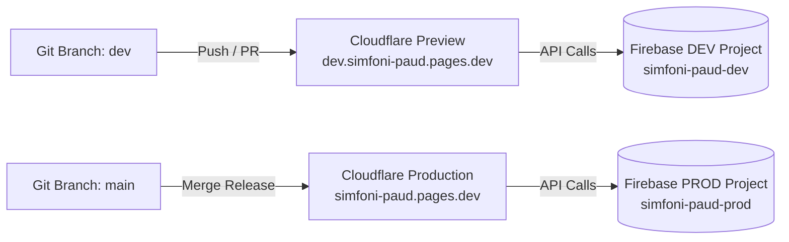

# 🚀 Panduan Deployment: Cloudflare Pages & Firebase CI/CD Pipeline

Dokumen ini memuat panduan lengkap untuk melakukan konfigurasi pipeline CI/CD, deployment multi-environment (**DEV vs PROD**), dan pengaturan variabel lingkungan **SIMFONI PAUD (SaaS Edition)** menggunakan **Cloudflare Pages** dan dua proyek **Firebase**.

---

## 1. Arsitektur Dual Environment (DEV & PROD)

Untuk mencegah uji coba fitur baru merusak data sekolah aktif, platform menggunakan dua konfigurasi terpisah:



| Komponen | Environment DEVELOPMENT 🟡 | Environment PRODUCTION 🟢 |
| :--- | :--- | :--- |
| **Branch Git** | `dev` | `main` |
| **Proyek Firebase** | `simfoni-paud-dev` | `simfoni-paud-prod` |
| **Cloudflare Environment** | Preview Deployments | Production Deployment |
| **URL Akses** | `https://dev.simfoni-paud.pages.dev` | `https://simfoni-paud.pages.dev` |
| **Peruntukan** | Uji coba fitur baru, QA, dan eksperimen | Sekolah mitra aktif (TK DWP 8, dll.) |

---

## 2. Pengaturan Variabel Lingkungan (Environment Variables)

### 2.1. Berkas `.env.example`
File ini tersimpan di Git sebagai cetak biru struktur variabel yang dibutuhkan:
```env
VITE_APP_ENV=development
VITE_FIREBASE_API_KEY=your_api_key
VITE_FIREBASE_AUTH_DOMAIN=your_project.firebaseapp.com
VITE_FIREBASE_PROJECT_ID=your_project_id
VITE_FIREBASE_STORAGE_BUCKET=your_project.appspot.com
VITE_FIREBASE_MESSAGING_SENDER_ID=your_sender_id
VITE_FIREBASE_APP_ID=your_app_id
```

### 2.2. Pengembangan Lokal (Laptop)
Buat file `.env.local` pada direktori root proyek dan isi dengan kredensial dari proyek Firebase **`simfoni-paud-dev`**.  
File ini otomatis diabaikan oleh Git via `.gitignore`.

**Opsional — Firebase Local Emulator Suite:** set `VITE_USE_FIREBASE_EMULATOR=true` (dan `VITE_FIREBASE_PROJECT_ID=demo-simfoni`), lalu jalankan `firebase emulators:start` (port di `firebase.json`: Auth 9099, Firestore 8080, Storage 9199). Data uji tidak menyentuh project dev.

### 2.2a. Secrets Cloudflare Worker (Reset Sandi ke Default)
Endpoint `/api/admin/reset-password` membutuhkan Service Account Firebase Admin per environment:
```bash
# Firebase Console > Project Settings > Service accounts > Generate new private key
npx wrangler secret put FIREBASE_PROJECT_ID        # simfoni-paud-dev / simfoni-paud-prod
npx wrangler secret put FIREBASE_SERVICE_ACCOUNT   # tempel seluruh isi JSON service account
```
Tanpa secrets ini, endpoint mengembalikan `503` dan aplikasi otomatis memakai fallback tautan reset via email. **Jangan pernah** menaruh JSON service account di repo atau variabel `VITE_*` (akan terbundel ke browser).

### 2.3. Pengaturan di Cloudflare Pages Dashboard
1. Buka dashboard Cloudflare: **Workers & Pages** -> Pilih proyek `simfoni-paud`.
2. Masuk ke **Settings** -> **Environment variables**.
3. Masukkan variabel untuk masing-masing tab:
   * **Tab Production (Branch `main`):**
     * `VITE_APP_ENV` = `production`
     * `VITE_FIREBASE_API_KEY` = *(API Key `simfoni-paud-prod`)*
     * `VITE_FIREBASE_PROJECT_ID` = `simfoni-paud-prod`
     * *(dan parameter Firebase PROD lainnya)*
   * **Tab Preview (Branch `dev`):**
     * `VITE_APP_ENV` = `development`
     * `VITE_FIREBASE_API_KEY` = *(API Key `simfoni-paud-dev`)*
     * `VITE_FIREBASE_PROJECT_ID` = `simfoni-paud-dev`
     * *(dan parameter Firebase DEV lainnya)*

---

## 3. Pengaturan Build & Branch di Cloudflare Pages

Atur konfigurasi build pada menu **Settings -> Builds & deployments**:

| Parameter | Nilai Konfigurasi |
| :--- | :--- |
| **Framework Preset** | `Vite` |
| **Build Command** | `npm run build` |
| **Build Output Directory** | `dist` |
| **Production Branch** | `main` |
| **Preview Branches** | Pilih *All non-production branches* atau spesifik branch `dev` |
| **Node.js Version** | `20` (diset via variabel `NODE_VERSION=20`) |

### Penanganan Deployment Cloudflare (Workers with Static Assets):
Proyek menggunakan Cloudflare Workers with Static Assets yang dikonfigurasi via [`wrangler.jsonc`](wrangler.jsonc):
* **Build Command (Dashboard):** `npm run build`
* **Deploy Command (Dashboard):** `npx wrangler deploy`
* **Worker API:** `"main": "worker/index.js"` dengan `"run_worker_first": ["/api/*"]`; selain `/api/*` disajikan langsung dari static assets (`ASSETS` binding). Membutuhkan Wrangler versi terbaru yang mendukung `run_worker_first` berbentuk array.
* **Routing SPA Tanpa 404:** Ditangani secara bawaan oleh konfigurasi `"not_found_handling": "single-page-application"` di `wrangler.jsonc`. 
  > [!NOTE]
  > File `_redirects` dengan isi `/* /index.html 200` tidak digunakan pada Cloudflare Workers Assets karena memicu error validasi *infinite loop* (Error Code `100324`). SPA routing ditangani 100% oleh Wrangler.

---

## 4. Konfigurasi Wajib di Firebase Console

### 4.1. Authorized Domains (Firebase Authentication)
Wajib mendaftarkan domain Cloudflare di masing-masing project Firebase agar proses autentikasi tidak ditolak:
* **Pada `simfoni-paud-dev`:**
  * Tambahkan `localhost`
  * Tambahkan `dev.simfoni-paud.pages.dev`
* **Pada `simfoni-paud-prod`:**
  * Tambahkan `simfoni-paud.pages.dev` (serta custom domain sekolah jika ada).

### 4.2. Penerapan Rules & Indeks
Konfigurasi ada di [`firebase.json`](../firebase.json) dan [`firestore.indexes.json`](../firestore.indexes.json). Terapkan ke kedua proyek Firebase:
```powershell
# 1. Terapkan ke lingkungan DEV
firebase use simfoni-paud-dev
firebase deploy --only firestore:rules,firestore:indexes,storage

# 2. Terapkan ke lingkungan PROD
firebase use simfoni-paud-prod
firebase deploy --only firestore:rules,firestore:indexes,storage
```
* Saat deploy `storage.rules` pertama kali, setujui permintaan izin *cross-service rules* (Storage membaca `users` di Firestore).
* Indeks komposit `attendance`/`journals` (`school_id` + `tanggal`) wajib ada untuk halaman Rekap per bulan, dan `audit_logs` (`school_id` + `timestamp` desc) untuk Riwayat Aktivitas Kepsek.
* **Setelah deploy rules versi kuota-server**, Superadmin wajib login sekali dan membuka Dashboard agar counter `jumlah_guru_aktif` setiap sekolah tersinkron; sebelum itu Kepsek tidak dapat menambah guru.

### 4.2a. Service Worker (PWA)
`public/sw.js` didaftarkan otomatis pada build produksi. Saat mengubah strategi cache, naikkan konstanta `CACHE` (mis. `simfoni-shell-v2`) agar cache lama dibersihkan. Aset Vite ber-hash sehingga rilis baru tetap terambil (navigasi selalu *network-first*).

### 4.3. CORS Bucket Storage (Foto & Stempel di PDF)
Generator PDF memuat logo, stempel, dan foto ke `<canvas>` sehingga bucket memerlukan CORS. Tanpa ini PDF tetap terbentuk, namun gambar dilewati.
```bash
# cors.json: [{"origin": ["https://simfoni-paud.pages.dev","https://dev.simfoni-paud.pages.dev","http://localhost:3000"],"method": ["GET"],"maxAgeSeconds": 3600}]
gsutil cors set cors.json gs://<storage-bucket-project>
```

---

## 5. Verifikasi Fitur PWA (Progressive Web App)

Pastikan file `public/manifest.json` memuat metadata aplikasi:
* Nama: `SIMFONI PAUD`
* Short Name: `SIMFONI`
* Start URL: `/`
* Display: `standalone`
* Theme Color: `#f59e0b` (Warm Honey)

Uji instalasi di smartphone:
1. Akses link `https://dev.simfoni-paud.pages.dev` atau `https://simfoni-paud.pages.dev` dari Chrome Android / Safari iOS.
2. Pastikan prompt *Add to Home Screen* muncul dan aplikasi dapat dibuka dalam mode layar penuh tanpa address bar browser.
