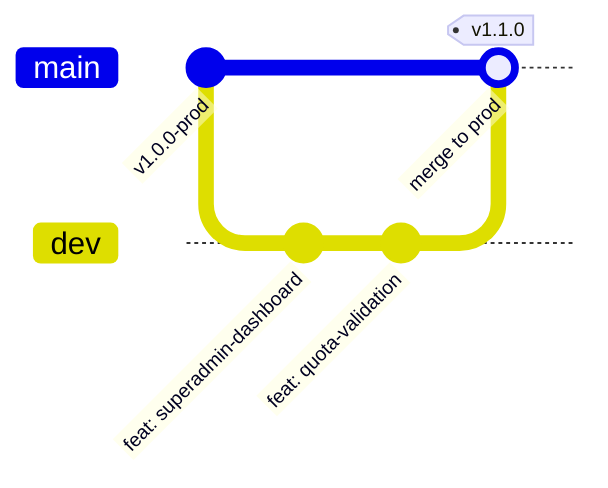

# 🛠️ Aturan Pengembangan & Standar Kode (Development Rules)

Dokumen ini berisi pedoman penulisan kode, konvensi teknis multi-tenant, alur kerja Git Dev vs Prod, serta **aturan wajib sinkronisasi dokumentasi** untuk pengembangan aplikasi **SIMFONI PAUD (SaaS Edition)**.

---

## 1. Aturan Emas: Sinkronisasi Dokumentasi (Documentation Sync Policy)

> [!CAUTION]
> ### 🛑 PROTOKOL ANTI-LUPA: KEWAJIBAN SINKRONISASI DOKUMENTASI SEBELUM & SESUDAH KODING
> **SETIAP ADA PENAMBAHAN FITUR BARU, REFACTORING, ATAU PERUBAHAN ALUR: WAJIB MEMPERBARUI DOKUMEN MARKDOWN (`.md`) TERLEBIH DAHULU SEBELUM EKSEKUSI KODE, DAN MEMPERBARUINYA KEMBALI SETELAH TESTING.**  
> Tidak ada pekerjaan yang dianggap selesai (*done*) sebelum dokumentasi yang terdampak telah disinkronkan dan dicatat ke `/data/Projects/project.md`!

### Matriks Pembaruan Berkas Saat Terjadi Fitur Baru / Perubahan:
1. **Penambahan Fitur Baru & Alur Kerja:** Menambah halaman, fitur mandiri (misal: Presensi Mandiri Kepala Sekolah), tombol aksi, siklus status laporan, kompresi, atau alur presensi.  
   👉 *Wajib perbarui:* [`features-and-workflow.md`](features-and-workflow.md)
2. **Perubahan Skema Database:** Menambah koleksi baru, menambah field baru, atau mengubah format Document ID.  
   👉 *Wajib perbarui:* [`database-schema.md`](database-schema.md)
3. **Perubahan Keamanan & Hak Akses:** Mengubah permission, matriks RBAC 3 tingkat, atau logika `firestore.rules` / `storage.rules`.  
   👉 *Wajib perbarui:* [`security-rules.md`](security-rules.md)
4. **Perubahan Arsitektur & Lingkungan:** Mengubah struktur folder, pola `secondaryAuth`, konfigurasi Dev vs Prod, atau library utama.  
   👉 *Wajib perbarui:* [`architecture.md`](architecture.md)
5. **Perubahan Deployment & CI/CD:** Mengubah variabel lingkungan (`.env`), Cloudflare Pages branch preview/production, atau Authorized Domains.  
   👉 *Wajib perbarui:* [`deployment.md`](deployment.md)
6. **Perubahan Roadmap Global:** Perubahan milestone, fase proyek, dan daftar tugas pengerjaan.  
   👉 *Wajib perbarui:* [`AGENTS.md`](../AGENTS.md)
7. **Pencatatan Registry Proyek:** Rekam jejak checkpoint eksekusi dan hasil testing wajib dicatat pada registry proyek.  
   👉 *Wajib perbarui:* `/data/Projects/project.md`

---

## 2. Aturan Wajib Testing: Live Testing & Checking Database

> [!CAUTION]
> ### 🧪 PROTOKOL MUTLAK: SETIAP PENAMBAHAN FITUR WAJIB LIVE TESTING & CHECKING DATABASE
> **Dilarang keras melapor selesai atau mengajukan commit sebelum melakukan live testing nyata pada fitur baru dan memeriksa integritas basis data (database check).**
>
> 1. **Live Testing Fungsional:**
>    - Verifikasi render komponen di lingkungan antarmuka (UI).
>    - Uji fungsionalitas tombol aksi, alur form input, serta penanganan error.
>    - Pastikan kompilasi produksi `npm run build` tuntas sukses 100%.
2. **Checking Database & Audit Firestore Rules (PRD Security Policy):**
   - **Audit Firestore Rules:** Setiap penambahan fitur baru, field baru, atau koleksi baru, **WAJIB mengecek kecukupan aturan di `firestore.rules` dan dokumen PRD Keamanan (`security-rules.md`)**. Pastikan tidak lupa memperbarui dan memperketat `firestore.rules` ketika diperlukan (misalnya membatasi wewenang create/update hanya untuk role tertentu, mencegah eskalasi hak akses, dan melindungi integritas multi-tenant).
   - Periksa integritas skema dokumen yang ditulis ke koleksi Firestore (keberadaan `school_id`, timestamp, tipe data).
   - Uji kepatuhan Firestore Security Rules (hak akses peran `superadmin`, `kepsek`, `guru`, dan isolasi tenant antar-sekolah).
   - Cegah celah kebocoran data (*zero security leaks*) dan manipulasi *spoofing* identitas sekolah.
> 3. **Pencatatan Registry:**
>    - Seluruh hasil live testing dan pengecekan database wajib dicatat di `/data/Projects/project.md`.

---

## 3. Standar Kueri Multi-Tenant (Tenant Data Isolation)

1. **Wajib Filter `school_id`:**  
   Setiap kueri Firestore yang dijalankan oleh pengguna tenant (`kepsek` atau `guru`) **HARUS** menyertakan filter `school_id`:
   ```javascript
   // Contoh kueri jurnal yang aman
   const q = query(
     collection(db, "journals"),
     where("school_id", "==", currentUser.school_id),
     where("status", "==", "dikirim"),
     orderBy("tanggal", "desc")
   );
   ```
2. **Akses Global Superadmin:**  
   Hanya pengguna dengan `role === 'superadmin'` yang diperkenankan melakukan kueri tanpa filter `school_id` (misal untuk statistik analitik SaaS global).
3. **Validasi Kuota Guru Sebelum Registrasi:**  
   Sebelum memanggil fungsi pendaftaran guru, periksa jumlah guru aktif di sekolah terkait. Jangan izinkan pendaftaran jika sudah mencapai batas `kuota_guru`.

---

## 3. Alur Kerja Git & Siklus Rilis (Git Workflow: Dev vs Prod)

> [!CAUTION]
> ### ⛔ ATURAN MUTLAK GIT: DILARANG AUTO-COMMIT & AUTO-PUSH!
> **AI Agent DILARANG KERAS melakukan `git commit` dan `git push` secara otomatis/mandiri.**
> 1. Perubahan hanya diterapkan di *working directory* lokal.
> 2. Berikan kesempatan kepada Pengguna untuk me-review hasil kerja secara menyeluruh.
> 3. `git commit` dan `git push` HANYA dieksekusi setelah ada instruksi perintah eksplisit dari Pengguna!

Untuk melindungi data sekolah mitra yang sedang aktif, pengembang **dilarang langsung membuat fitur baru di branch `main`**. Ikuti alur kerja berikut:



1. **Langkah 1 (Fitur Baru di Branch `dev`):**
   ```bash
   git checkout dev
   npm run dev
   ```
   *Pengembangan lokal menggunakan kredensial Firebase Uji Coba (`simfoni-paud-dev`).*
2. **Langkah 2 (Push ke Cloudflare Preview):**
   ```bash
   git add .
   git commit -m "feat: nama fitur baru"
   git push origin dev
   ```
   *Cloudflare otomatis men-deploy ke `https://dev.simfoni-paud.pages.dev` untuk pengujian di smartphone.*
3. **Langkah 3 (Rilis ke Production):**
   *Setelah dipastikan stabil dan tidak ada regresi:*
   ```bash
   git checkout main
   git merge dev
   git push origin main
   ```
   *Cloudflare otomatis mempublikasikan pembaruan ke link utama sekolah mitra.*

---

## 4. Konvensi Kode & Best Practices

1. **Pemisahan Secondary Auth:**  
   Fungsi pendaftaran akun (`createKepsekAccountBySuperadmin` dan `createGuruAccountByKepsek`) **WAJIB** memakai `secondaryAuth` dan segera melakukan `signOut(secondaryAuth)` setelah record berhasil disimpan.
2. **Dynamic Branding:**  
   Jangan melakukan *hardcode* nama sekolah atau logo di komponen antarmuka maupun generator PDF. Selalu konsumsi dari `schoolData` pada `AuthContext`.
3. **Cleanup Firestore Listeners:**  
   Setiap fungsi `onSnapshot` di dalam `useEffect` wajib mengembalikan fungsi pembersih (*unsubscribe*):
   ```javascript
   useEffect(() => {
     if (!currentUser?.school_id) return;
     const unsubscribe = onSnapshot(q, (snapshot) => {
       // proses data
     });
     return () => unsubscribe();
   }, [currentUser?.school_id]);
   ```
4. **Keamanan Kredensial:**  
   File `.env`, `.env.local`, `.env.development`, dan `.env.production` **DILARANG** di-commit ke Git. Hanya berkas `.env.example` yang boleh tersimpan di repositori.
5. **Tanggal Operasional = Tanggal Lokal:**  
   Dilarang memakai `new Date().toISOString().split('T')[0]` untuk tanggal presensi/jurnal (UTC → absen sebelum 07:00 WIB tercatat kemarin). Gunakan `getLocalDateString()`, `getLocalMonthString()`, `getLocalTimeString()` dari `src/utils/formatters.js`.
6. **Konfigurasi Sekolah Lewat Helper:**  
   Jam masuk/pulang, toleransi, hari kerja, daftar kelompok, dan password default dibaca dari `src/utils/schoolConfig.js`. Dilarang meng-hardcode `'07:45'`, `'TK A'`, `'Guru1234!'`, dsb. di komponen.
7. **Penulisan Ramah Offline:**  
   Penulisan operasional guru dibungkus `commitWrite()` (`src/utils/offlineWrite.js`). Untuk dokumen baru gunakan `doc(collection(db, 'x'))` + `setDoc` (bukan `addDoc`, yang menunggu server).
8. **Audit Log:**  
   Panggil `logActivity({ schoolId, actorId, actorNama, action, recordType, recordId, detail })` dengan **satu objek** (bukan argumen posisi) dan kode aksi `UPPER_SNAKE_CASE`. Tidak perlu di-`await`. `actorId` harus UID sesi aktif (divalidasi rules).
8a. **Perubahan Status Akun Guru Wajib Lewat Helper:**  
   Gunakan `createGuruAccountByKepsek` / `toggleStatusGuruByKepsek` (batch + counter kuota). `updateDoc` langsung pada `status_akun` guru akan ditolak rules.
9. **Uji Rules Sebelum Deploy:**  
   Setiap perubahan `firestore.rules`/`storage.rules` wajib diuji di Firebase Emulator (lihat `docs/security-rules.md` §6). Ingat: Firestore meng-OR-kan semua `match` yang cocok.
10. **Indikator DEV Mode:**  
   Komponen `DevBadge.jsx` wajib terpasang di layout aplikasi untuk menampilkan label peringatan visual saat berjalan di luar mode production.
11. **Larangan Mutlak Dialog Browser Bawaan (No Native Popups):**  
   **DILARANG KERAS** menggunakan `window.alert()`, `window.confirm()`, atau `window.prompt()`. Seluruh dialog interaktif (konfirmasi hapus, penonaktifan akun, reset sandi, notifikasi galat) **WAJIB** menggunakan komponen modal kustom elegan ([`src/components/ui/ModalKonfirmasi.jsx`](../src/components/ui/ModalKonfirmasi.jsx)) dengan backdrop blur, transisi halus, badge ikon tematik, dan tata letak ramah pengguna PAUD (tidak memunculkan teks kaku seperti *"localhost:3000 says"*).
12. **Wajib Indikator Loading pada Seluruh Operasi Asinkron (Anti-Silent Wait):**  
   Setiap operasi yang membutuhkan waktu tunggu (unggah media, eksekusi mutasi Firestore, unduh berkas PDF/Excel, hingga penarikan data) **WAJIB** membungkus siklusnya dengan state loading:
   - **Unggah Gambar:** Gunakan helper `uploadCompressedImage` atau `uploadFileWithProgress` dengan callback `onProgress`, lalu render komponen visual [`ProgressBar.jsx`](../src/components/ui/ProgressBar.jsx).
   - **Blok Try-Catch-Finally:** State loading (`setLoading(false)`, `setSubmitting(false)`, `setUploadProgress(...)`) **HARUS** di-reset di dalam blok `finally` agar UI tidak macet/terkunci jika terjadi galat jaringan.
   - **Disabled Button:** Seluruh tombol aksi pemicu mutasi asinkron wajib memiliki properti `disabled={submitting}` dan ikon spinner `animate-spin` saat proses berlangsung.
