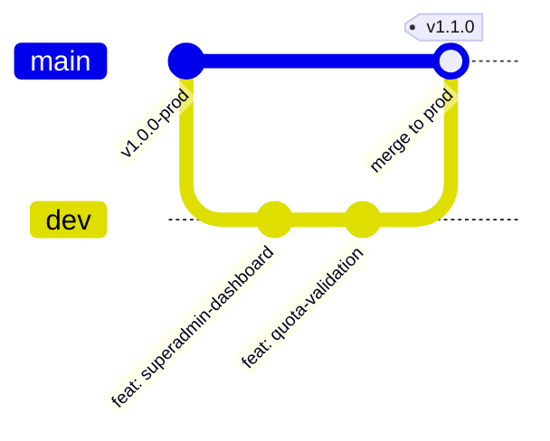

# 🛠️ Aturan Pengembangan & Standar Kode (Development Rules)

Dokumen ini berisi pedoman penulisan kode, konvensi teknis multi-tenant, alur kerja Git Dev vs Prod, serta **aturan wajib sinkronisasi dokumentasi** untuk pengembangan aplikasi **SIMFONI PAUD (SaaS Edition)**.

---

## 1. Aturan Emas: Sinkronisasi Dokumentasi (Documentation Sync Policy)

> [!CAUTION]
> ### 🛑 PROTOKOL ANTI-LUPA: KEWAJIBAN SINKRONISASI DOKUMENTASI
> Setiap kali terjadi **Perubahan Besar (*Major Change*)** pada arsitektur SaaS, skema basis data, hak akses keamanan, dependensi, alur kerja, atau konfigurasi CI/CD, Anda **WAJIB** memperbarui file-file dokumentasi kecil terkait di folder `docs/*.md` dan `AGENTS.md`.  
> Tidak ada pekerjaan yang dianggap selesai (*done*) sebelum dokumentasi yang terdampak telah disinkronkan!

### Matriks Pembaruan Berkas Saat Terjadi Perubahan:
1. **Perubahan Skema Database:** Menambah koleksi baru, menambah field baru, atau mengubah format Document ID.  
   👉 *Wajib perbarui:* [`database-schema.md`](database-schema.md)
2. **Perubahan Keamanan & Hak Akses:** Mengubah permission, matriks RBAC 3 tingkat, atau logika `firestore.rules` / `storage.rules`.  
   👉 *Wajib perbarui:* [`security-rules.md`](security-rules.md)
3. **Perubahan Arsitektur & Lingkungan:** Mengubah struktur folder, pola `secondaryAuth`, konfigurasi Dev vs Prod, atau library utama.  
   👉 *Wajib perbarui:* [`architecture.md`](architecture.md)
4. **Perubahan Modul & Alur Kerja:** Menambah halaman, fitur Superadmin, siklus status laporan, kompresi, atau alur presensi.  
   👉 *Wajib perbarui:* [`features-and-workflow.md`](features-and-workflow.md)
5. **Perubahan Deployment & CI/CD:** Mengubah variabel lingkungan (`.env`), Cloudflare Pages branch preview/production, atau Authorized Domains.  
   👉 *Wajib perbarui:* [`deployment.md`](deployment.md)
6. **Perubahan Roadmap Global:** Perubahan milestone dan daftar tugas pengerjaan.  
   👉 *Wajib perbarui:* [`AGENTS.md`](../AGENTS.md)

---

## 2. Standar Kueri Multi-Tenant (Tenant Data Isolation)

1. **Wajib Filter `school_id`:**  
   Setiap kueri Firestore yang dijalankan oleh pengguna tenant (`kepsek` atau `guru`) **HARUS** menyertakan filter `school_id`:
   ```javascript
   // Contoh kueri jurnal yang aman
   const q = query(
     collection(db, "journals"),
     where("school_id", "==", currentUser.school_id),
     where("status", "==", "dikirim"),
     orderBy("tanggal", "desc")
   );
   ```
2. **Akses Global Superadmin:**  
   Hanya pengguna dengan `role === 'superadmin'` yang diperkenankan melakukan kueri tanpa filter `school_id` (misal untuk statistik analitik SaaS global).
3. **Validasi Kuota Guru Sebelum Registrasi:**  
   Sebelum memanggil fungsi pendaftaran guru, periksa jumlah guru aktif di sekolah terkait. Jangan izinkan pendaftaran jika sudah mencapai batas `kuota_guru`.

---

## 3. Alur Kerja Git & Siklus Rilis (Git Workflow: Dev vs Prod)

> [!CAUTION]
> ### ⛔ ATURAN MUTLAK GIT: DILARANG AUTO-COMMIT & AUTO-PUSH!
> **AI Agent DILARANG KERAS melakukan `git commit` dan `git push` secara otomatis/mandiri.**
> 1. Perubahan hanya diterapkan di *working directory* lokal.
> 2. Berikan kesempatan kepada Pengguna untuk me-review hasil kerja secara menyeluruh.
> 3. `git commit` dan `git push` HANYA dieksekusi setelah ada instruksi perintah eksplisit dari Pengguna!

Untuk melindungi data sekolah mitra yang sedang aktif, pengembang **dilarang langsung membuat fitur baru di branch `main`**. Ikuti alur kerja berikut:



1. **Langkah 1 (Fitur Baru di Branch `dev`):**
   ```bash
   git checkout dev
   npm run dev
   ```
   *Pengembangan lokal menggunakan kredensial Firebase Uji Coba (`simfoni-paud-dev`).*
2. **Langkah 2 (Push ke Cloudflare Preview):**
   ```bash
   git add .
   git commit -m "feat: nama fitur baru"
   git push origin dev
   ```
   *Cloudflare otomatis men-deploy ke `https://dev.simfoni-paud.pages.dev` untuk pengujian di smartphone.*
3. **Langkah 3 (Rilis ke Production):**
   *Setelah dipastikan stabil dan tidak ada regresi:*
   ```bash
   git checkout main
   git merge dev
   git push origin main
   ```
   *Cloudflare otomatis mempublikasikan pembaruan ke link utama sekolah mitra.*

---

## 4. Konvensi Kode & Best Practices

1. **Pemisahan Secondary Auth:**  
   Fungsi pendaftaran akun (`createKepsekAccountBySuperadmin` dan `createGuruAccountByKepsek`) **WAJIB** memakai `secondaryAuth` dan segera melakukan `signOut(secondaryAuth)` setelah record berhasil disimpan.
2. **Dynamic Branding:**  
   Jangan melakukan *hardcode* nama sekolah atau logo di komponen antarmuka maupun generator PDF. Selalu konsumsi dari `schoolData` pada `AuthContext`.
3. **Cleanup Firestore Listeners:**  
   Setiap fungsi `onSnapshot` di dalam `useEffect` wajib mengembalikan fungsi pembersih (*unsubscribe*):
   ```javascript
   useEffect(() => {
     if (!currentUser?.school_id) return;
     const unsubscribe = onSnapshot(q, (snapshot) => {
       // proses data
     });
     return () => unsubscribe();
   }, [currentUser?.school_id]);
   ```
4. **Keamanan Kredensial:**  
   File `.env`, `.env.local`, `.env.development`, dan `.env.production` **DILARANG** di-commit ke Git. Hanya berkas `.env.example` yang boleh tersimpan di repositori.
5. **Indikator DEV Mode:**  
   Komponen `DevBadge.jsx` wajib terpasang di layout aplikasi untuk menampilkan label peringatan visual saat berjalan di luar mode production.
6. **Larangan Mutlak Dialog Browser Bawaan (No Native Popups):**  
   **DILARANG KERAS** menggunakan `window.alert()`, `window.confirm()`, atau `window.prompt()`. Seluruh dialog interaktif (konfirmasi hapus, penonaktifan akun, reset sandi, notifikasi galat) **WAJIB** menggunakan komponen modal kustom elegan ([`src/components/ui/ModalKonfirmasi.jsx`](../src/components/ui/ModalKonfirmasi.jsx)) dengan backdrop blur, transisi halus, badge ikon tematik, dan tata letak ramah pengguna PAUD (tidak memunculkan teks kaku seperti *"localhost:3000 says"*).
