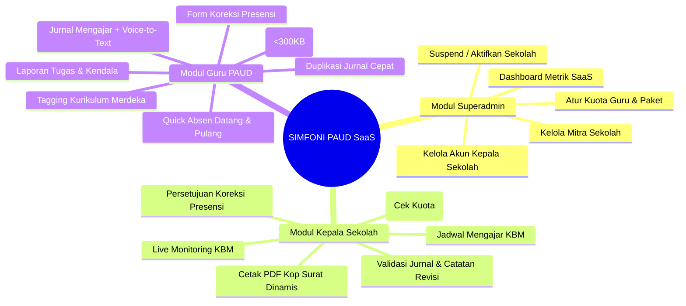
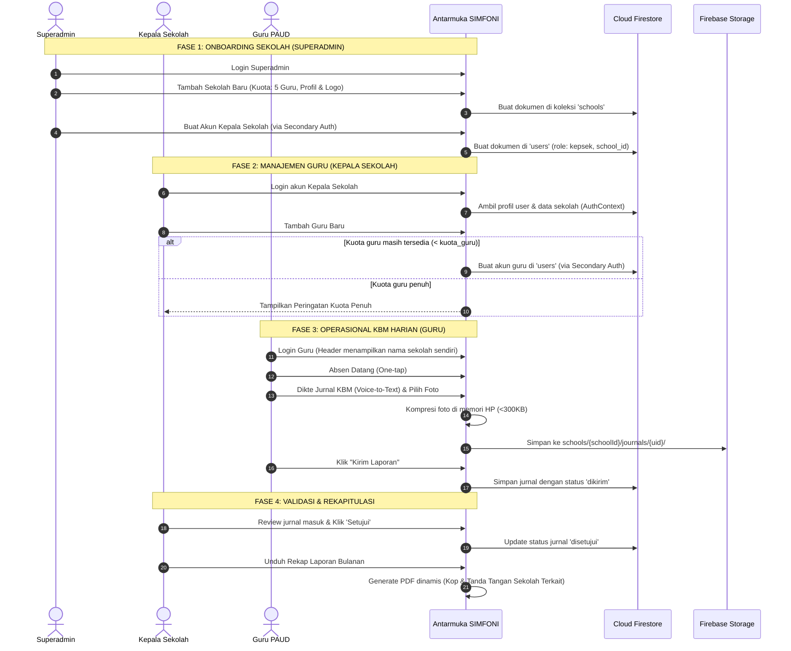

# 📱 Fitur Utama, Alur Kerja & Inovasi Pengguna (SaaS Multi-Tenant)

Dokumen ini menjelaskan modul fungsional, alur kerja operasional (user workflow), modul Superadmin SaaS, serta inovasi kemudahan penggunaan aplikasi **SIMFONI PAUD** untuk Superadmin, Kepala Sekolah, dan Guru PAUD.

---

## 1. Modul Aplikasi Berdasarkan Peran



---

## 2. Pintu Masuk Login Tunggal & Pembagian Dashboard Terpisah

### 2.1. Pintu Masuk Tunggal (Single Stealth Login Gateway)
* **Satu Halaman untuk Semua Peran:** Superadmin, Kepala Sekolah, dan Guru masuk melalui form login yang sama di URL `/login`.
* **Desain Bersih & Tak Terdeteksi (Stealth):**
  * Tidak ada tombol pilihan peran (*dropdown* peran atau tab "Login Admin" / "Login Guru").
  * Pengguna luar atau guru tidak akan mendeteksi keberadaan portal Superadmin atau struktur hierarki khusus dari tampilan antarmuka login.
* **Auto-Routing Berbasis Peran:**  
  Setelah kredensial (email & password) diverifikasi Firebase Auth, `AuthContext` membaca dokumen `users/{uid}` dari Firestore dan langsung mengarahkan (*redirect*) ke dashboard yang sesuai:
  ```javascript
  if (userData.role === 'superadmin') {
    navigate('/superadmin/dashboard');
  } else if (userData.role === 'kepsek') {
    navigate('/kepsek/dashboard');
  } else {
    navigate('/guru/dashboard');
  }
  ```

### 2.2. Tiga Dashboard Terpisah (Dedicated Dashboards per Role)
Masing-masing peran memiliki dashboard eksklusif yang dirancang spesifik sesuai fungsi kerjanya:

1. **Dashboard Superadmin (`/superadmin/dashboard`):**
   * Eksklusif untuk Project Owner (Pemilik SaaS).
   * Menampilkan metrik global seluruh sekolah mitra, status aktif/tenggang/nonaktif sekolah, pemakaian kuota guru per sekolah, dan jalan pintas onboarding tenant baru.
   * Dilarang keras diakses oleh Kepala Sekolah maupun Guru (dijaga oleh `ProtectedRoute`).
2. **Dashboard Kepala Sekolah (`/kepsek/dashboard`):**
   * Eksklusif untuk pimpinan sekolah tenant bersangkutan.
   * Menampilkan monitoring *real-time* kehadiran guru hari ini, antrean jurnal KBM yang butuh validasi/revisi, pengajuan koreksi jam absen guru, dan kendala sekolah.
   * Dilarang diakses oleh Guru.
3. **Dashboard Guru PAUD (`/guru/dashboard`):**
   * Eksklusif untuk tenaga pendidik.
   * Menampilkan tombol cepat Presensi Datang/Pulang, status kelengkapan jurnal hari ini, dan jadwal KBM aktif hari ini.

---

## 3. Rincian Modul Superadmin (`/superadmin/*`)

### 3.1. Dashboard Superadmin (`/superadmin/dashboard`)
* **Kartu Ringkasan Metrik SaaS:** Total Sekolah Mitra, Sekolah Aktif vs Nonaktif, Total Guru Terdaftar di seluruh sekolah, dan Peringatan Sekolah yang Masa Langganannya Segera Habis (< 30 hari).
* **Pintasan Cepat:** Tombol **"+ Tambah Sekolah & Kepsek Baru"** untuk onboarding sekolah mitra secara instan.

### 3.2. Kelola Sekolah / Tenant (`/superadmin/sekolah`)
* **Tabel & Kartu Sekolah Mitra:** Menampilkan Nama Sekolah, Kota, Paket Langganan (`trial`, `basic`, `pro`), Pemakaian Kuota Guru (contoh: `4 / 5 Guru`), Masa Berlaku, dan Status Akun.
* **Modal Tambah / Edit Sekolah:**
  * Input field: Nama Sekolah, NPSN, Alamat Lengkap, Kota, Telepon, Nama Kepala Sekolah Resmi (untuk penandatangan dokumen PDF), NIP/NUPTK, Paket Langganan, Kuota Maksimum Guru, Tanggal Akhir Masa Berlaku, dan Unggah Logo Sekolah.
* **Fitur Suspend / Nonaktifkan Sekolah:**
  * Superadmin dapat menonaktifkan status langganan sekolah (`status_langganan: "nonaktif"`). Seluruh staf (Kepsek dan Guru) sekolah tersebut otomatis tidak dapat mengakses sistem dan diarahkan ke layar penangguhan layanan.

### 3.3. Kelola Akun Kepala Sekolah (`/superadmin/kepsek`)
* Pendaftaran akun Kepala Sekolah baru menggunakan **Secondary Firebase App Instance** (`secondaryAuth`) sehingga sesi login Superadmin tidak terganggu.
* Form pendaftaran: Pilih Sekolah Mitra (`school_id`), Nama Lengkap Kepala Sekolah, Email Login, dan Password Default.
* Pengaturan reset status akun (`aktif` / `nonaktif`) dan ganti password.

---

## 4. Rincian Modul Kepala Sekolah (`/kepsek/*`)

### 4.1. Dashboard Monitoring Live
* Pemantauan real-time guru yang telah absen datang/pulang hari ini di sekolahnya.
* Notifikasi antrean jurnal mengajar baru berstatus `dikirim` yang siap diperiksa.
* Notifikasi pengajuan koreksi absen dan kendala sarpras yang butuh tindak lanjut.

### 4.2. Kelola Akun Guru & Validasi Kuota
* **Pengecekan Kuota Otomatis:** Saat Kepala Sekolah menekan tombol **"Tambah Guru Baru"**, sistem menghitung jumlah akun guru aktif di sekolah tersebut.
  * Jika jumlah guru aktif < `schoolData.kuota_guru`: Form pendaftaran via `secondaryAuth` terbuka.
  * Jika kuota telah penuh: Sistem menampilkan modal dialog peringatan:  
    *"Kuota akun guru untuk paket sekolah Anda telah penuh (X/X Guru). Silakan hubungi Administrator Sistem (Superadmin) untuk menambah kuota."*
* Fitur Edit Profil Guru dan Nonaktifkan Akun (*Soft Delete*) saat guru mutasi atau berhenti bertugas.

### 4.3. Validasi Jurnal & Koreksi Presensi
* Memberikan status `disetujui` atau `perlu_revisi` (dengan kolom catatan revisi terperinci).
* Memberikan keputusan pada pengajuan koreksi jam presensi guru (`disetujui` / `ditolak`).

### 4.4. Dynamic Branding & Cetak PDF Kop Surat Otomatis
* Seluruh data identitas sekolah (Nama Sekolah, Alamat, Logo, dan Nama Kepala Sekolah) dimuat secara dinamis dari `schoolData` pada `AuthContext`.
* Generator PDF (`pdfExporter.js`) mencetak Kop Surat resmi dan kolom tanda tangan Kepala Sekolah yang **sepenuhnya otomatis mengikuti data sekolah yang sedang aktif**, tanpa ada teks sekolah yang di-*hardcode*.

---

## 5. Rincian Modul Guru (`/guru/*`)

1. **Presensi Cepat & Geotagging:** Tombol datang/pulang satu ketukan dengan pencatatan jam server presisi serta koordinat GPS opsional.
2. **Jurnal KBM Harian:** Form terstruktur mencakup Topik, Capaian Pembelajaran Kurikulum Merdeka, Kegiatan Pembuka-Inti-Penutup, Refleksi, dan Kendala.
3. **Voice-to-Text (`id-ID`):** Menggunakan Web Speech API agar guru PAUD dapat mendiktekan narasi kegiatan langsung menggunakan mikrofon smartphone.
4. **Kompresi Foto Klien (< 300 KB):** Foto dari kamera smartphone otomatis dikompresi di browser sebelum proses unggah untuk menghemat kuota guru.
5. **Tagging Kurikulum Merdeka & Salin Jurnal:** Checkbox cepat Capaian Pembelajaran dan tombol duplikasi jurnal dari hari sebelumnya.
6. **Laporan Tugas Tambahan & Kendala:** Form pelaporan rapat gugus, lomba anak, administrasi RPPH, dan sarana yang rusak.

---

## 6. Alur Kerja Pengguna (User Journey & Lifecycle)



---

## 6. Fitur Penunjang & Keandalan Operasional

### 6.1. Inisialisasi Sistem SaaS Pertama (Pilot Seeder)
Pada saat sistem baru pertama kali dipasang dan koleksi `users` di database masih kosong:
* Halaman `Login.jsx` mendeteksi status kosong dan memunculkan tombol:  
  **"Inisialisasi Sistem SaaS (Setup Superadmin & Sekolah Pertama)"**.
* Wizard ini akan otomatis membuat:
  1. Akun `superadmin` pertama untuk Project Owner.
  2. Mitra sekolah pilot pertama di koleksi `schools` yaitu **"TK Dharma Wanita Persatuan 8"** dengan status `aktif` dan kuota `5 Guru`.

### 6.2. Indikator Lingkungan (DEV Environment Badge)
* Komponen `DevBadge.jsx` akan merender label mengambang berwarna oranye/kuning bertuliskan **`DEV ENVIRONMENT`** di sudut kanan atas layar saat `import.meta.env.VITE_APP_ENV !== 'production'`.
* Ini mencegah Project Owner atau tester salah mengira lingkungan pengujian sebagai lingkungan produksi sekolah sungguhan.
