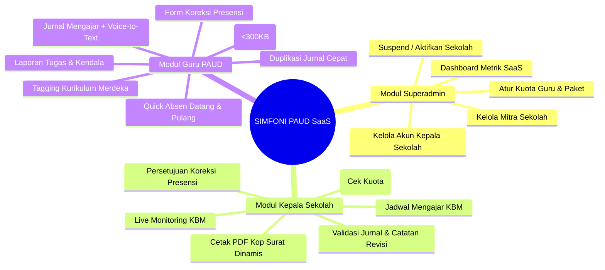
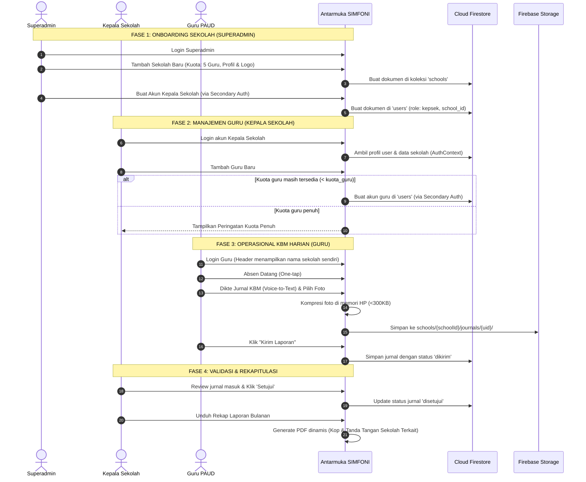

# 📱 Fitur Utama, Alur Kerja & Inovasi Pengguna (SaaS Multi-Tenant)

Dokumen ini menjelaskan modul fungsional, alur kerja operasional (user workflow), modul Superadmin SaaS, serta inovasi kemudahan penggunaan aplikasi **SIMFONI PAUD** untuk Superadmin, Kepala Sekolah, dan Guru PAUD.

---

## 1. Modul Aplikasi Berdasarkan Peran



---

## 2. Pintu Masuk Login Tunggal & Pembagian Dashboard Terpisah

### 2.1. Pintu Masuk Tunggal (Single Stealth Login Gateway)
* **Satu Halaman untuk Semua Peran:** Superadmin, Kepala Sekolah, dan Guru masuk melalui form login yang sama di URL `/login`.
* **Desain Bersih & Tak Terdeteksi (Stealth):**
  * Tidak ada tombol pilihan peran (*dropdown* peran atau tab "Login Admin" / "Login Guru").
  * Pengguna luar atau guru tidak akan mendeteksi keberadaan portal Superadmin atau struktur hierarki khusus dari tampilan antarmuka login.
* **Auto-Routing Berbasis Peran:**  
  Setelah kredensial (email & password) diverifikasi Firebase Auth, `AuthContext` membaca dokumen `users/{uid}` dari Firestore dan langsung mengarahkan (*redirect*) ke dashboard yang sesuai:
  ```javascript
  if (userData.role === 'superadmin') {
    navigate('/superadmin/dashboard');
  } else if (userData.role === 'kepsek') {
    navigate('/kepsek/dashboard');
  } else {
    navigate('/guru/dashboard');
  }
  ```

### 2.2. Tiga Dashboard Terpisah (Dedicated Dashboards per Role)
Masing-masing peran memiliki dashboard eksklusif yang dirancang spesifik sesuai fungsi kerjanya:

1. **Dashboard Superadmin (`/superadmin/dashboard`):**
   * Eksklusif untuk Project Owner (Pemilik SaaS).
   * Menampilkan metrik global seluruh sekolah mitra, status aktif/tenggang/nonaktif sekolah, pemakaian kuota guru per sekolah, dan jalan pintas onboarding tenant baru.
   * Dilarang keras diakses oleh Kepala Sekolah maupun Guru (dijaga oleh `ProtectedRoute`).
2. **Dashboard Kepala Sekolah (`/kepsek/dashboard`):**
   * Eksklusif untuk pimpinan sekolah tenant bersangkutan.
   * Menampilkan monitoring *real-time* kehadiran guru hari ini, antrean jurnal KBM yang butuh validasi/revisi, pengajuan koreksi jam absen guru, dan kendala sekolah.
   * Dilarang diakses oleh Guru.
3. **Dashboard Guru PAUD (`/guru/dashboard`):**
   * Eksklusif untuk tenaga pendidik.
   * Menampilkan tombol cepat Presensi Datang/Pulang, status kelengkapan jurnal hari ini, dan jadwal KBM aktif hari ini.

---

## 3. Rincian Modul Superadmin (`/superadmin/*`)

### 3.1. Dashboard Superadmin (`/superadmin/dashboard`)
* **Kartu Ringkasan Metrik SaaS:** Total Sekolah Mitra, Sekolah Aktif vs Nonaktif, Total Guru Terdaftar di seluruh sekolah, dan Peringatan Sekolah yang Masa Langganannya Segera Habis (< 30 hari).
* **Monitoring Storage Meter SaaS:** Indikator total akumulasi foto terunggah dan estimasi penggunaan memori Firebase Storage per sekolah serta agregat global untuk deteksi dini batas 5 GB Spark Plan.
* **Pintasan Cepat:** Tombol **"+ Tambah Sekolah & Kepsek Baru"** untuk onboarding sekolah mitra secara instan.

### 3.2. Kelola Sekolah / Tenant (`/superadmin/sekolah`)
* **Tabel & Kartu Sekolah Mitra:** Menampilkan Nama Sekolah, Kota, Paket Langganan (`trial`, `basic`, `pro`), Pemakaian Kuota Guru (contoh: `4 / 5 Guru`), Masa Berlaku, dan Status Akun.
* **Modal Tambah / Edit Sekolah:**
  * Input field: Nama Sekolah, NPSN, Alamat Lengkap, Kota, Telepon, Nama Kepala Sekolah Resmi (untuk penandatangan dokumen PDF), NIP/NUPTK, Paket Langganan, Kuota Maksimum Guru, Tanggal Akhir Masa Berlaku, Unggah Logo Sekolah, dan **Unggah Stempel/Cap Digital Sekolah (PNG Transparan)**.
  * **Fitur Durasi Trial Dinamis (Dynamic Days by Admin):** Saat paket `trial` dipilih, Superadmin memiliki preset durasi cepat (+7, +14, +30, +60 hari) yang secara dinamis menghitung tanggal kedaluwarsa `berlaku_hingga` dan kuota guru otomatis.
* **Sistem Gating Fitur Berdasarkan Paket (*Plan Feature Gating*):**
  * **Paket Trial:** Presensi dan Jurnal KBM dasar dengan durasi dinamis oleh Admin. Menampilkan banner floating trial reminder di dashboard sekolah.
  * **Paket Basic (Standard):** Kuota hingga 10 Guru, Presensi Dual Timestamp, Jurnal Kurikulum Merdeka + Dikte Suara (Voice-to-Text `id-ID`), kompresi foto kamera HP (< 300 KB), Ekspor PDF Ringkas Kop Resmi & Stempel Transparan, serta Share to WhatsApp.
  * **Paket Pro (Full Akreditasi):** Seluruh fitur Basic ditambah fitur eksklusif:
    1. **Ekspor Portofolio Foto BAN-PDM:** Bukti fisik akreditasi PAUD lengkap dengan foto dan capaian pembelajaran.
    2. **Ekspor Spreadsheet Excel (.xlsx):** Rekapitulasi presensi bulanan untuk honorarium / uang transport guru.
    3. **Fitur "Setujui Sekaligus" (*Bulk Approval*):** Review dan persetujuan massal jurnal KBM sekali klik.
* **Fitur Suspend / Nonaktifkan Sekolah:**
  * Superadmin dapat menonaktifkan status langganan sekolah (`status_langganan: "nonaktif"`), atau sistem otomatis menonaktifkan sekolah jika tanggal `berlaku_hingga` telah terlewati. Seluruh staf (Kepsek dan Guru) sekolah tersebut otomatis tidak dapat mengakses sistem dan diarahkan ke layar penangguhan layanan.

### 3.3. Kelola Akun Kepala Sekolah (`/superadmin/kepsek`)
* Pendaftaran akun Kepala Sekolah baru menggunakan **Secondary Firebase App Instance** (`secondaryAuth`) sehingga sesi login Superadmin tidak terganggu.
* Form pendaftaran: Pilih Sekolah Mitra (`school_id`), Nama Lengkap Kepala Sekolah, Email Login, dan Password Default.
* **Fitur Reset Password Kepala Sekolah:** Tombol reset instan password Kepala Sekolah ke default (`Kepsek1234!`) tanpa perlu buka email.

### 3.4. Manajemen Log & Pembersihan Data Berkala (`/superadmin/logs`)
Mengingat keterbatasan kuota penyimpanan dan pembacaan/penulisan Firestore, Superadmin memiliki modul pemeliharaan log:
* **Tabel Pemantauan Audit Global:** Melihat log seluruh aktivitas penting (penambahan sekolah, pembuatan user, perubahan status, persetujuan jurnal) dengan filter sekolah, aktor, dan tanggal.
* **Fitur Pembersihan Log Manual (*Manual Purge*):**
  * Tombol **"Bersihkan Log Lama"** dengan modal opsi:
    * *Hapus log lebih lama dari 30 hari*
    * *Hapus log lebih lama dari 60 hari*
    * *Hapus log lebih lama dari 90 hari*
    * *Rentang tanggal kustom*
  * Menampilkan hitungan jumlah log yang akan dihapus sebelum eksekusi konfirmasi.
* **Fitur Pembersihan Otomatis Periodik (*Periodic Retention Job*):**
  * Superadmin dapat mengatur durasi retensi otomatis (misal: simpan 60 hari terakhir).
  * Sistem secara periodik menjalankan pembersihan data usang (*background cleanup batch*) yang kedaluwarsa, lalu memperbarui status eksekusi terakhir di `system_settings.last_cleanup_timestamp`.
  * Menjamin basis data tetap ramping, cepat di-load, dan tidak melebihi batas kuota gratis/berbayar Firestore.

---

## 4. Rincian Modul Kepala Sekolah (`/kepsek/*`)

### 4.1. Dashboard Monitoring Live
* Pemantauan real-time guru yang telah absen datang/pulang hari ini di sekolahnya.
* **Deteksi Lupa Absen Pulang:** Kartu status otomatis menandai guru yang sudah absen datang namun belum checkout setelah pukul 18:00.
* Notifikasi antrean jurnal mengajar baru berstatus `dikirim` yang siap diperiksa.
* Notifikasi pengajuan koreksi absen dan kendala sarpras yang butuh tindak lanjut.

### 4.2. Kelola Akun Guru, Validasi Kuota & Reset Password
* **Pengecekan Kuota Otomatis:** Saat Kepala Sekolah menekan tombol **"Tambah Guru Baru"**, sistem menghitung jumlah akun guru aktif di sekolah tersebut.
  * Jika jumlah guru aktif < `schoolData.kuota_guru`: Form pendaftaran via `secondaryAuth` terbuka.
  * Jika kuota telah penuh: Sistem menampilkan modal dialog peringatan:  
    *"Kuota akun guru untuk paket sekolah Anda telah penuh (X/X Guru). Silakan hubungi Administrator Sistem (Superadmin) untuk menambah kuota."*
* **Tombol Reset Password Guru ke Default (Solusi Lupa Sandi):**  
  Kepsek dapat mereset sandi guru yang lupa langsung dari daftar guru menjadi password default (`Guru1234!`) dan menandai `wajib_ganti_password: true`. Guru tidak perlu repot membuka email inbox.
* Fitur Edit Profil Guru dan Nonaktifkan Akun (*Soft Delete*) saat guru mutasi atau berhenti bertugas.

### 4.3. Validasi Jurnal & Fitur "Setujui Sekaligus" (Bulk Approval)
* Memberikan status `disetujui` atau `perlu_revisi` (dengan kolom catatan revisi terperinci) per dokumen.
* **Fitur "Setujui Sekaligus" (*Bulk Approval*):** Checkbox multi-select dan tombol sekali klik untuk menyetujui seluruh jurnal yang telah memenuhi syarat secara serentak, menghemat waktu Kepsek saat mereview puluhan laporan mingguan.
* Memberikan keputusan pada pengajuan koreksi jam presensi guru (`disetujui` / `ditolak`).

### 4.4. Rekapitulasi Laporan Multi-Format (PDF Ringkas, Portofolio & Excel)
* **1. Cetak Rekap PDF Ringkas (Format Administrasi/Dinas):**  
  Menghasilkan PDF tabel presensi dan ringkasan topik KBM dengan Kop Surat resmi, tanda tangan, dan **stempel/cap digital sekolah otomatis**. Ringan (< 500 KB), render instan, dan 100% aman dibuka di HP tanpa risiko browser *crash*.
* **2. Cetak Rekap PDF Lengkap (Portofolio Foto):**  
  Menghasilkan dokumen lengkap beserta lampiran foto dokumentasi pembelajaran resolusi tinggi untuk arsip akreditasi BAN-PDM (direkomendasikan diunduh via laptop).
* **3. Ekspor Data Excel (`.xlsx`):**  
  Ekspor rekapitulasi presensi (total kehadiran, menit keterlambatan, izin, sakit) ke format Spreadsheet Excel untuk keperluan **perhitungan gaji / uang transport / honorarium guru** oleh Kepala Sekolah dan Bendahara.
* **4. Fitur "Bagikan Rekap ke WhatsApp" (*One-Click WA Share*):**  
  Tombol cepat untuk membuat pesan terformat rapi dan langsung membuka WhatsApp Web / Aplikasi WA HP untuk mengirimkan rekap bulanan ke Yayasan atau Pengawas Sekolah.

---

## 5. Rincian Modul Guru (`/guru/*`)

1. **Presensi Cepat Dual Timestamp (Anti-Trap Offline):**  
   Mencatat `jam_datang_device` (waktu lokal saat tombol ditekan) dan `jam_datang_server`. Jika sinkronisasi tertunda karena sinyal drop, guru tidak akan dirugikan sebagai terlambat.
2. **Penanganan Lupa Absen Pulang:**  
   Jika jam telah melewati 18:00 dan guru lupa checkout, sistem otomatis menyajikan tombol pengajuan koreksi absen pulang keesokan harinya.
3. **Modal Wajib Ganti Password:**  
   Jika akun guru baru saja direset oleh Kepsek (`wajib_ganti_password: true`), sistem langsung memunculkan modal pembuatan kata sandi baru saat login pertama berhasil.
4. **Jurnal KBM Harian:** Form terstruktur mencakup Topik, Capaian Pembelajaran Kurikulum Merdeka, Kegiatan Pembuka-Inti-Penutup, Refleksi, dan Kendala.
5. **Bank Template Kegiatan KBM Kurikulum Merdeka:**  
   Pilihan template cepat sekali klik (*Upacara & Pembiasaan Pagi*, *Motorik Kasar & Senam*, *Sentra Sains Eksperimen*, *Sentra Seni & Kreativitas*, *Literasi Awal*) yang otomatis mengisi isian kegiatan sehingga guru cukup mengedit sedikit narasi (hemat waktu hingga 90%).
6. **Voice-to-Text (`id-ID`):** Menggunakan Web Speech API agar guru PAUD dapat mendiktekan narasi kegiatan langsung menggunakan mikrofon smartphone.
7. **Kompresi Foto Klien (< 300 KB):** Foto dari kamera smartphone otomatis dikompresi di browser sebelum proses unggah untuk menghemat kuota guru.
8. **Tagging Kurikulum Merdeka & Salin Jurnal:** Checkbox cepat Capaian Pembelajaran dan tombol duplikasi jurnal dari hari sebelumnya.
9. **Fitur "Bagikan Jurnal ke WhatsApp":**  
   Tombol sekali sentuh untuk membagikan ringkasan KBM hari ini (topik, kegiatan, nama guru, status disetujui) ke grup WhatsApp Paguyuban Orang Tua Murid / Yayasan.
10. **Laporan Tugas Tambahan & Kendala:** Form pelaporan rapat gugus, lomba anak, administrasi RPPH, dan sarana yang rusak.

---

## 6. Alur Kerja Pengguna (User Journey & Lifecycle)



---

## 7. Fitur Penunjang & Keandalan Operasional

### 7.1. Inisialisasi Sistem SaaS Pertama (Pilot Seeder)
Pada saat sistem baru pertama kali dipasang dan koleksi `users` di database masih kosong:
* Halaman `Login.jsx` mendeteksi status kosong dan memunculkan tombol:  
  **"Inisialisasi Sistem SaaS (Setup Superadmin & Sekolah Pertama)"**.
* Wizard ini akan otomatis membuat:
  1. Akun `superadmin` pertama untuk Project Owner.
  2. Mitra sekolah pilot pertama di koleksi `schools` yaitu **"TK Dharma Wanita Persatuan 8"** dengan status `aktif` dan kuota `5 Guru`.

### 7.2. Indikator Lingkungan (DEV Environment Badge)
* Komponen `DevBadge.jsx` akan merender label mengambang berwarna oranye/kuning bertuliskan **`DEV ENVIRONMENT`** di sudut kanan atas layar saat `import.meta.env.VITE_APP_ENV !== 'production'`.
* Ini mencegah Project Owner atau tester salah mengira lingkungan pengujian sebagai lingkungan produksi sekolah sungguhan.

### 7.3. Banner Indikator Jaringan Visual (`NetworkStatusBanner.jsx`)
* Memantau konektivitas internet perangkat (`navigator.onLine`) secara *real-time*:
  * 🟢 **Mode Online:** Sistem tersinkronisasi penuh dengan Firebase Cloud.
  * 🟠 **Mode Offline:** Tampil banner peringatan ramah di bagian atas: *"Sinyal terputus. Jangan khawatir, draf Anda tersimpan aman di HP dan otomatis terkirim saat internet kembali."*
* Mencegah guru panik atau melakukan penekanan tombol berulang kali (*spam click*) saat berada di area sekolah bersinyal lemah.

---

## 8. Standar Desain Antarmuka Human-Centered & Acuan Mockup UI

Aplikasi SIMFONI PAUD secara ketat menerapkan estetika **Anti-AI Slop** yang dirancang khusus untuk memenuhi kebutuhan psikologis dan ergonomis guru anak usia dini:
* 📄 **Prototipe Acuan Visual Interaktif:** [`docs/mockup-ui-paud-guru.html`](mockup-ui-paud-guru.html) (atau via browser dev: `http://localhost:3000/mockup-ui-paud-guru.html`).
* 📘 **Pedoman Desain Lengkap:** [`docs/ui-design-guidelines.md`](ui-design-guidelines.md).
* **Fitur Utama Estetika:**
  1. **Palet Warm Honey & Sage Green:** Latar hangat bebas silau, aksen ceria terakota dan madu, serta aksen hijau sage yang menenangkan.
  2. **Font Pairing Ramah:** `Nunito` (`font-brand`) untuk judul ceria yang bersahabat dan `Plus Jakarta Sans` untuk kejelasan teks formulir.
  3. **Ergonomi Ramah Jempol (*Thumb-Zone*):** Tombol aksi utama berukuran 44px+ dengan radius membulat empuk (`rounded-2xl` / `rounded-3xl`).
  4. **Navigasi Bawah Melayang (*Floating Bottom Nav Pill*):** Kapsul navigasi melayang semi-transparan dengan efek blur kaca (*backdrop blur*) yang nyaman dijangkau jempol satu tangan.

