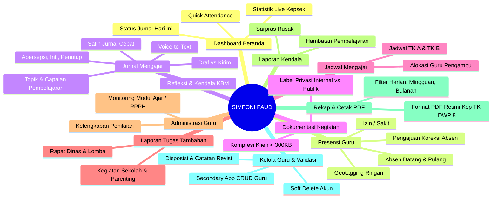
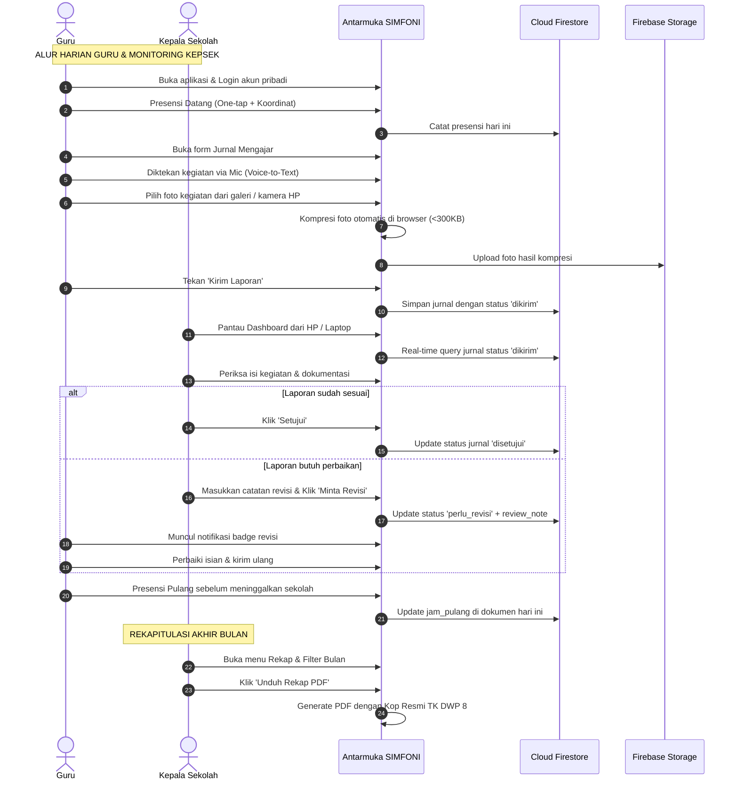

# 📱 Fitur Utama, Alur Kerja & Inovasi Pengguna

Dokumen ini menjelaskan 10 modul fungsional, alur kerja operasional harian (user workflow), serta fitur improvisasi kemudahan penggunaan aplikasi **SIMFONI PAUD** untuk guru dan Kepala Sekolah di **TK Dharma Wanita Persatuan 8**.

---

## 1. Daftar 10 Modul Terintegrasi

### 1.1. Dashboard Beranda
* **Tampilan Guru:** Kartu status kehadiran hari ini (tombol cepat absen datang/pulang), pengingat status pengisian jurnal hari ini (belum diisi, draf, dikirim, atau revisi), dan jadwal mengajar hari aktif.
* **Tampilan Kepala Sekolah:** Rekapitulasi real-time jumlah guru yang sudah hadir, jurnal masuk yang menunggu persetujuan, pengajuan koreksi presensi yang butuh konfirmasi, dan kendala sekolah yang belum terselesaikan.

### 1.2. Presensi Guru
* Pencatatan jam datang dan jam pulang dengan tombol sekali tekan (*one-tap*).
* Status: `hadir`, `terlambat`, `izin`, atau `sakit`.
* Opsi pengambilan lokasi GPS (latitude & longitude) secara non-intrusif sebagai informasi pelengkap untuk Kepala Sekolah.
* Form pengajuan koreksi presensi jika guru lupa menekan tombol absen atau terkendala jaringan, lengkap dengan alasan dan input jam koreksi.

### 1.3. Jurnal Mengajar
* Pemilihan Kelompok: TK A atau TK B.
* Penulisan Topik Pembelajaran dan Tujuan KBM.
* Tiga tahapan kegiatan terstruktur: **Kegiatan Pembuka (Apersepsi)**, **Kegiatan Inti**, dan **Kegiatan Penutup**.
* Kolom **Refleksi Guru** dan **Kendala KBM**.
* Mode penyimpanan ganda: **"Simpan Draf"** (belum dikirim ke Kepsek) dan **"Kirim Laporan"** (masuk ke antrean verifikasi Kepsek).

### 1.4. Dokumentasi Kegiatan
* Terintegrasi langsung di dalam form Jurnal Mengajar.
* Unggah foto aktivitas anak didik dengan kompresi otomatis di sisi browser.
* Input keterangan (caption) per foto serta pemilihan label privasi: `internal` (arsip internal saja) atau `publik` (layak publikasi).

### 1.5. Jadwal Mengajar
* Matriks jadwal mingguan dari Senin sampai Sabtu.
* Pengaturan alokasi kelompok (TK A / TK B / Bersama) dan PIC guru yang bertugas.
* Kepala Sekolah memiliki akses modifikasi penuh; guru memiliki akses baca untuk panduan mengajar.

### 1.6. Laporan Kegiatan & Tugas Tambahan
* Wadah untuk mencatat kegiatan kedinasan di luar jam kelas rutin:
  * Rapat koordinasi gugus / IGTKI / dinas pendidikan.
  * Pendampingan lomba anak atau pentas seni.
  * Pertemuan wali murid (parenting) dan rapat internal yayasan.

### 1.7. Administrasi Guru
* Monitoring digital kelengkapan perangkat ajar mingguan/semesteran (RPPH, modul ajar kurikulum merdeka, asesmen capaian perkembangan anak).
* Guru dapat menandai progres dokumen dan Kepala Sekolah dapat memverifikasi status kelengkapannya.

### 1.8. Laporan Kendala
* Saluran pelaporan cepat jika ditemukan fasilitas sekolah rusak, kekurangan bahan ajar/alat peraga edukatif (APE), atau hambatan khusus pada anak didik.
* Kepala Sekolah dapat memberikan tanggapan status (`dilaporkan` -> `diproses` -> `selesai`).

### 1.9. Rekap Laporan & Cetak PDF Resmi
* Filter data berdasarkan rentang tanggal, bulan, kelompok kelas, atau guru tertentu.
* Fitur ekspor dokumen PDF formal menggunakan `jspdf` & `jspdf-autotable`:
  * Dilengkapi Kop Surat resmi **TK Dharma Wanita Persatuan 8**.
  * Kolom tanda tangan Kepala Sekolah dan Guru Kelas.
  * Siap dicetak langsung untuk keperluan arsip akreditasi BAN-PDM / Pengawas Sekolah.

### 1.10. Validasi Kepala Sekolah & Kelola Guru
* Panel verifikasi terpadu untuk memeriksa jurnal guru: Kepala Sekolah dapat memberikan status `disetujui` atau mengembalikan dengan status `perlu_revisi` disertai catatan perbaikan yang jelas.
* Panel persetujuan koreksi absen guru (`disetujui` / `ditolak`).
* Panel Manajemen Akun Guru: Menambah guru baru, mengubah informasi guru, atau menonaktifkan akun (*soft delete*) tanpa me-*logout* Kepala Sekolah.

---

## 2. Alur Penggunaan (User Journey & Lifecycle)

---

## 3. Fitur Inovasi & Kemudahan Operasional

### 3.1. Antarmuka Mobile-First & Adaptif
* **Layar Smartphone (`< 768px`):** Menggunakan *Bottom Navigation Bar* ergonomis yang mudah dijangkau dengan ibu jari satu tangan.
* **Layar Tablet/Desktop (`>= 768px`):** Otomatis berpindah menjadi *Sidebar Navigation* yang lapang untuk kemudahan analisis Kepala Sekolah saat mengoperasikan laptop.
* **PWA (Progressive Web App):** Dilengkapi `manifest.json` agar guru dapat memasang ikon aplikasi di layar utama (*Homescreen*) HP Android/iOS tanpa perlu mendownload dari Play Store.

### 3.2. Kompresi Foto Otomatis Sisi Klien (Client-Side Compression)
* Foto dari kamera smartphone masa kini umumnya berukuran 3 MB hingga 10 MB per foto. Mengunggahnya langsung akan menghabiskan kuota guru dan memperlambat sistem.
* Menggunakan library `browser-image-compression` untuk memproses gambar di memori browser sebelum request jaringan:
  * Dimensi maksimum: `1280px`
  * Format: `.webp` atau `.jpg` optimal
  * Ukuran target: **< 300 KB** (reduksi ukuran hingga > 90% dengan ketajaman visual tetap jelas untuk laporan).

### 3.3. Dikte Jurnal dengan Suara (Voice-to-Text)
* Guru PAUD sering memiliki waktu terbatas untuk mengetik uraian kegiatan panjang di layar sentuh HP.
* Menggunakan **Web Speech API** bawaan browser dengan konfigurasi bahasa `id-ID` pada kolom Kegiatan Pembuka, Inti, Penutup, dan Refleksi.
* Guru cukup menekan tombol mikrofon dan berbicara santai, teks akan otomatis terisi secara *real-time*.

### 3.4. Tagging Kurikulum Merdeka PAUD & Salin Jurnal Cepat
* **Tagging Capaian Pembelajaran Cepat:** Checkbox satu klik untuk:
  1. *Nilai Agama dan Budi Pekerti*
  2. *Jati Diri*
  3. *Dasar-dasar Literasi, Matematika, Sains, Teknologi, Rekayasa, dan Seni (STEAM)*
* **Fitur "Salin Jurnal ke Jurnal Baru":** Tombol duplikasi dari entri jurnal sebelumnya sehingga guru tidak perlu mengetik ulang struktur modul ajar yang berkesinambungan.

### 3.5. Initial Admin Setup Seeding
* Pada instalasi pertama saat basis data `users` masih belum memiliki akun apa pun, halaman `Login.jsx` secara cerdas mendeteksi kondisi kosong ini dan menampilkan form khusus: **"Inisialisasi Akun Kepala Sekolah Pertama"**.
* Ini memastikan deployment awal di Cloudflare Pages dapat langsung dioperasikan tanpa perlu konfigurasi manual via Firebase Console.

