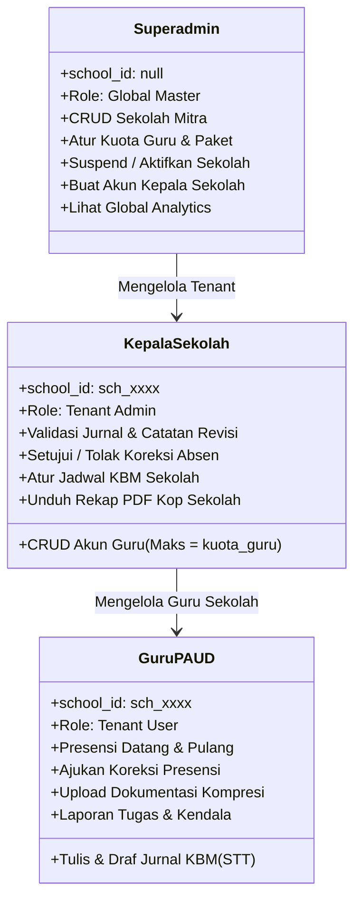

# 🔒 Aturan Keamanan & Hak Akses (Multi-Tenant RBAC)

Dokumen ini memuat matriks hak akses 3 tingkat (*3-Tier Role-Based Access Control*), implementasi resmi berkas `firestore.rules` dan `storage.rules` untuk arsitektur Multi-Tenant SaaS, serta kebijakan isolasi data sekolah di **SIMFONI PAUD**.

---

## 1. Tiga Tingkat Peran Pengguna (3-Tier RBAC)



---

## 2. Matriks Hak Akses (RBAC Matrix)

| Fitur / Aksi | Guru (`guru`) | Kepala Sekolah (`kepsek`) | Superadmin (`superadmin`) |
| :--- | :---: | :---: | :---: |
| **Melihat & Ubah Profil Sendiri** | Ya | Ya | Ya |
| **Presensi Mandiri** | Ya (sekolah sendiri) | Ya (akun sendiri) | - |
| **Mengajukan Koreksi Absen** | Ya | Memeriksa & Memutuskan | Memantau |
| **Tulis Jurnal & Unggah Dokumentasi** | Ya (kelas sendiri) | Melihat seluruh jurnal sekolah | Melihat seluruh jurnal global |
| **Validasi & Revisi Jurnal Guru** | ❌ Dilarang | ✅ Ya (sekolah sendiri) | ✅ Ya (audit) |
| **Atur Jadwal Mengajar Sekolah** | ❌ Read-only | ✅ Ya (sekolah sendiri) | ✅ Ya (global) |
| **Tambah Akun Guru Baru** | ❌ Dilarang | ✅ Ya (dibatasi `kuota_guru`) | ✅ Ya |
| **Edit / Nonaktifkan Akun Guru** | ❌ Dilarang | ✅ Ya (sekolah sendiri) | ✅ Ya |
| **Unduh Rekap PDF Sekolah** | ❌ Dilarang | ✅ Ya (kop surat dinamis) | ✅ Ya |
| **Tambah / Edit Profil Sekolah Mitra** | ❌ Dilarang | ❌ Dilarang | ✅ Ya |
| **Ubah Kuota Guru & Paket Langganan**| ❌ Dilarang | ❌ Dilarang | ✅ Ya |
| **Suspend / Nonaktifkan Sekolah** | ❌ Dilarang | ❌ Dilarang | ✅ Ya |
| **Buat Akun Kepala Sekolah** | ❌ Dilarang | ❌ Dilarang | ✅ Ya (Secondary Auth) |
| **Akses Lintas Tenant (`school_id` lain)**| ❌ **DIBLOKIR** | ❌ **DIBLOKIR** | ✅ **Global Access** |

---

## 3. Implementasi `firestore.rules` (Multi-Tenant Isolation)

Letakkan kode ini pada berkas `firestore.rules` di root proyek:

```javascript
rules_version = '2';
service cloud.firestore {
  match /databases/{database}/documents {
    
    // --- FUNGSI HELPER KEAMANAN MULTI-TENANT ---
    function isSignedIn() {
      return request.auth != null;
    }
    
    function getUserData() {
      return get(/databases/$(database)/documents/users/$(request.auth.uid)).data;
    }
    
    function getSchoolData(schoolId) {
      return get(/databases/$(database)/documents/schools/$(schoolId)).data;
    }
    
    function isSuperAdmin() {
      return isSignedIn() && getUserData().role == 'superadmin' && getUserData().status_akun == 'aktif';
    }
    
    // Memastikan user aktif DAN sekolah tempatnya bernaung memiliki langganan aktif
    function isActiveTenantUser() {
      let user = getUserData();
      return isSignedIn() 
        && user.status_akun == 'aktif' 
        && user.school_id != null
        && getSchoolData(user.school_id).status_langganan == 'aktif';
    }
    
    function isSameSchool(schoolId) {
      return isActiveTenantUser() && getUserData().school_id == schoolId;
    }
    
    function isSchoolKepsek(schoolId) {
      return isSameSchool(schoolId) && getUserData().role == 'kepsek';
    }

    // --- 1. KOLEKSI SCHOOLS (DATA TENANT) ---
    match /schools/{schoolId} {
      allow read: if isSuperAdmin() || (isSignedIn() && getUserData().school_id == schoolId);
      allow create, delete: if isSuperAdmin();
      allow update: if isSuperAdmin() || isSchoolKepsek(schoolId);
    }

    // --- 2. KOLEKSI USERS ---
    match /users/{userId} {
      allow read: if isSuperAdmin() 
                  || (isSignedIn() && request.auth.uid == userId) 
                  || (isActiveTenantUser() && getUserData().school_id == resource.data.school_id);
      
      // Izinkan setup awal superadmin pertama, atau pembuatan akun oleh Superadmin,
      // atau pembuatan akun guru oleh Kepsek di sekolah yang sama
      allow create: if isSignedIn() && (
        request.auth.uid == userId 
        || isSuperAdmin() 
        || (isSchoolKepsek(request.resource.data.school_id) && request.resource.data.role == 'guru')
      );
      
      allow update: if isSuperAdmin() 
                    || (isSchoolKepsek(resource.data.school_id) && resource.data.role == 'guru')
                    || (isActiveTenantUser() && request.auth.uid == userId && !request.resource.data.diff(resource.data).affectedKeys().hasAny(['role', 'status_akun', 'school_id']));
      
      allow delete: if isSuperAdmin();
    }

    // --- 3. KOLEKSI ATTENDANCE (PRESENSI) ---
    match /attendance/{docId} {
      allow read: if isSuperAdmin() 
                  || isSchoolKepsek(resource.data.school_id) 
                  || (isSameSchool(resource.data.school_id) && resource.data.user_id == request.auth.uid);
      allow create: if isSameSchool(request.resource.data.school_id) && request.resource.data.user_id == request.auth.uid;
      allow update: if isSchoolKepsek(resource.data.school_id) 
                    || (isSameSchool(resource.data.school_id) && resource.data.user_id == request.auth.uid);
      allow delete: if false; // Presensi tidak boleh dihapus fisik
    }

    // --- 4. KOLEKSI JOURNALS (JURNAL KBM & DOKUMENTASI) ---
    match /journals/{journalId} {
      allow read: if isSuperAdmin() 
                  || isSchoolKepsek(resource.data.school_id) 
                  || (isSameSchool(resource.data.school_id) && resource.data.user_id == request.auth.uid);
      allow create: if isSameSchool(request.resource.data.school_id) && request.resource.data.user_id == request.auth.uid;
      allow update: if isSchoolKepsek(resource.data.school_id) 
                    || (isSameSchool(resource.data.school_id) && resource.data.user_id == request.auth.uid);
      allow delete: if isSameSchool(resource.data.school_id) && resource.data.user_id == request.auth.uid && resource.data.status == 'draf';
    }

    // --- 5. KOLEKSI SCHEDULES ---
    match /schedules/{scheduleId} {
      allow read: if isSuperAdmin() || isSameSchool(resource.data.school_id);
      allow write: if isSuperAdmin() || isSchoolKepsek(request.resource.data.school_id);
    }

    // --- 6. KOLEKSI TASKS & ISSUES ---
    match /tasks_and_issues/{itemId} {
      allow read: if isSuperAdmin() 
                  || isSchoolKepsek(resource.data.school_id) 
                  || (isSameSchool(resource.data.school_id) && resource.data.user_id == request.auth.uid);
      allow create: if isSameSchool(request.resource.data.school_id) && request.resource.data.user_id == request.auth.uid;
      allow update: if isSchoolKepsek(resource.data.school_id) 
                    || (isSameSchool(resource.data.school_id) && resource.data.user_id == request.auth.uid);
      allow delete: if isSchoolKepsek(resource.data.school_id);
    }

    // --- 7. KOLEKSI AUDIT LOGS ---
    match /audit_logs/{logId} {
      allow read: if isSuperAdmin() || isSchoolKepsek(resource.data.school_id);
      allow create: if isSignedIn();
      allow update, delete: if false; // Immutable
    }
  }
}
```

---

## 4. Implementasi `storage.rules` (Isolasi Media per Sekolah)

Setiap sekolah memiliki ruang penyimpanan terisolasi di Firebase Storage dengan format path:  
`schools/{schoolId}/journals/{userId}/{filename}`

Letakkan kode ini pada berkas `storage.rules` di root proyek:

```javascript
rules_version = '2';
service firebase.storage {
  match /b/{bucket}/o {
    
    // Direktori media terisolasi per tenant sekolah
    match /schools/{schoolId}/{allPaths=**} {
      allow read: if request.auth != null;
      allow write: if request.auth != null 
                   && request.resource.size < 2 * 1024 * 1024 // Maksimum 2MB
                   && request.resource.contentType.matches('image/.*');
    }
  }
}
```

---

## 5. Blokir Akses Otomatis Sekolah Non-Aktif (Suspension Policy)

Jika suatu sekolah mitra mengalami keterlambatan pembayaran atau dinonaktifkan oleh Superadmin (`status_langganan == 'nonaktif'`), maka fungsi `isActiveTenantUser()` pada Firestore Rules akan otomatis bernilai `false`.
Akibatnya:
1. Seluruh pembacaan dan penulisan dokumen oleh Kepala Sekolah dan Guru dari sekolah tersebut otomatis diblokir di tingkat database.
2. Di antarmuka aplikasi, `AuthContext` mendeteksi status ini dan mengalihkan pengguna ke halaman [`SuspendedSchool.jsx`](architecture.md#5-struktur-direktori-proyek) dengan pesan informatif:  
   *"Masa aktif layanan SIMFONI PAUD untuk sekolah Anda telah berakhir. Silakan hubungi Administrator Sistem."*
