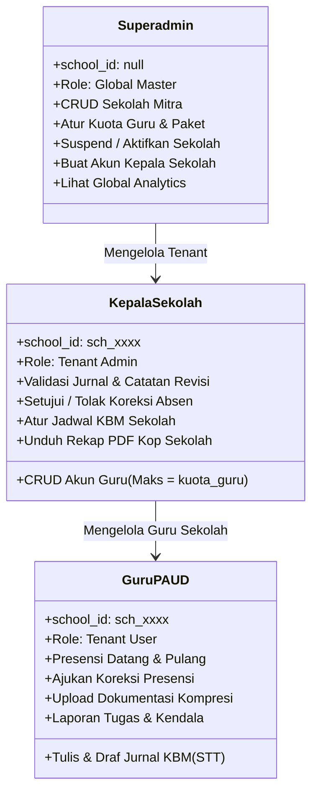

# 🔒 Aturan Keamanan & Hak Akses (Multi-Tenant RBAC)

Dokumen ini memuat matriks hak akses 3 tingkat (*3-Tier Role-Based Access Control*), implementasi resmi berkas `firestore.rules` dan `storage.rules` untuk arsitektur Multi-Tenant SaaS, serta kebijakan isolasi data sekolah di **SIMFONI PAUD**.

---

## 1. Tiga Tingkat Peran Pengguna (3-Tier RBAC)



---

## 2. Matriks Hak Akses (RBAC Matrix)

| Fitur / Aksi | Guru (`guru`) | Kepala Sekolah (`kepsek`) | Superadmin (`superadmin`) |
| :--- | :---: | :---: | :---: |
| **Melihat & Ubah Profil Sendiri** | Ya | Ya | Ya |
| **Presensi Mandiri** | Ya (sekolah sendiri) | Ya (akun sendiri) | - |
| **Mengajukan Koreksi Absen** | Ya | Memeriksa & Memutuskan | Memantau |
| **Tulis Jurnal & Unggah Dokumentasi** | Ya (kelas sendiri) | Melihat seluruh jurnal sekolah | Melihat seluruh jurnal global |
| **Validasi & Revisi Jurnal Guru** | ❌ Dilarang | ✅ Ya (sekolah sendiri) | ✅ Ya (audit) |
| **Atur Jadwal Mengajar Sekolah** | ❌ Read-only | ✅ Ya (sekolah sendiri) | ✅ Ya (global) |
| **Atur Jam Masuk/Pulang, Toleransi & Hari Kerja** | ❌ Dilarang | ✅ Ya (hanya field jam) | ✅ Ya |
| **Ajukan Izin / Sakit** | ✅ Ya (−7 s.d. +30 hari) | - | - |
| **Tanggapi Laporan Tugas & Kendala** | ❌ Dilarang | ✅ Ya (status & tanggapan) | Memantau |
| **Reset Sandi ke Default (tanpa email)** | ❌ Dilarang | ✅ Guru sekolah sendiri (via Worker) | ✅ Kepsek & Guru (via Worker) |
| **Melihat Profil/Email Rekan Kerja** | ❌ Dilarang | ✅ Guru sekolah sendiri | ✅ Global |
| **Tambah Akun Guru Baru** | ❌ Dilarang | ✅ Ya (dibatasi `kuota_guru`) | ✅ Ya |
| **Edit / Nonaktifkan Akun Guru** | ❌ Dilarang | ✅ Ya (sekolah sendiri) | ✅ Ya |
| **Unduh Rekap PDF Sekolah** | ❌ Dilarang | ✅ Ya (kop surat dinamis) | ✅ Ya |
| **Tambah / Edit Profil Sekolah Mitra** | ❌ Dilarang | ❌ Dilarang | ✅ Ya |
| **Ubah Kuota Guru & Paket Langganan**| ❌ Dilarang | ❌ Dilarang | ✅ Ya |
| **Suspend / Nonaktifkan Sekolah** | ❌ Dilarang | ❌ Dilarang | ✅ Ya |
| **Buat Akun Kepala Sekolah** | ❌ Dilarang | ❌ Dilarang | ✅ Ya (Secondary Auth) |
| **Melihat Audit Trail (`audit_logs`)** | ❌ Dilarang | ✅ Ya (sekolah sendiri) | ✅ Ya (global) |
| **Kelola Master Data 21 Siswa** | ✅ Ya (Dinamis: input & kelola murid di kelasnya) | ✅ Ya (seluruh kelas sekolah) | ✅ Ya (global) |
| **Input Presensi Harian Siswa** | ✅ Ya (kelas sendiri) | ✅ Ya (monitoring & input) | ✅ Ya |
| **Unggah Perangkat Ajar (RPPH)** | ✅ Ya (kelas sendiri) | ❌ Read & Review | ✅ Ya |
| **Validasi / Telaah RPPH** | ❌ Dilarang | ✅ Ya (sekolah sendiri) | ✅ Ya |
| **Asesmen Capaian Perkembangan Siswa** | ✅ Ya (kelas sendiri) | ✅ Ya (monitoring rekap) | ✅ Ya |
| **Supervisi & Evaluasi Kinerja Guru** | ❌ Hanya membaca hasil | ✅ Ya (mengisi instrumen) | ✅ Ya |
| **Pembersihan Log Audit (Purge/Retention)**| ❌ Dilarang | ❌ Dilarang | ✅ Ya (Manual & Periodik) |
| **Akses Lintas Tenant (`school_id` lain)**| ❌ **DIBLOKIR** | ❌ **DIBLOKIR** | ✅ **Global Access** |

---

## 3. Implementasi `firestore.rules` (Multi-Tenant Isolation)

Prinsip utama implementasi:
1. **Firestore meng-OR-kan semua `match` yang cocok.** Aturan wildcard untuk koleksi masa depan WAJIB mengecualikan koleksi inti; versi lama tanpa pengecualian membuat guru bisa mengubah dokumen `users` rekan sesekolah (termasuk `role`) dan menyetujui jurnalnya sendiri.
2. **Batasi field yang boleh berubah** (`diff().affectedKeys().hasOnly([...])`) untuk setiap peran, bukan hanya siapa yang boleh menulis.
3. **Self-create superadmin hanya saat bootstrap** (`system_settings/general_config` belum ada).
4. **Waktu dari server** (`== request.time`) untuk `jam_datang_server`, `jam_pulang_server`, dan `audit_logs.timestamp`.
5. **Rentang tanggal presensi**: absen hadir hanya untuk tanggal hari ini (toleransi sinkron offline 3 hari); izin/sakit −7 s.d. +30 hari.
6. **Kuota guru ditegakkan server**: pembuatan, aktivasi, dan nonaktivasi guru oleh Kepsek WAJIB satu batch dengan perubahan `schools.jumlah_guru_aktif` (+1/−1) dan `counter_ref_uid`. Rules memverifikasi selisih status guru via `get()`/`getAfter()` dan menolak bila counter melebihi `kuota_guru`. Sekolah tanpa counter (data lama) menolak pendaftaran sampai disinkronkan Superadmin.
7. **`get` dokumen yang belum ada**: `resource == null`, sehingga cek "sudah absen hari ini?" diizinkan khusus untuk ID berpola `{school_id}_{YYYY-MM-DD}_{uid}` milik sendiri.

Isi lengkap berkas [`firestore.rules`](../firestore.rules):

```javascript
rules_version = '2';
service cloud.firestore {
  match /databases/{database}/documents {

    // =====================================================================
    // FUNGSI HELPER KEAMANAN MULTI-TENANT
    // Catatan: Firestore meng-OR-kan semua aturan `match` yang cocok, jadi
    // aturan wildcard di bagian bawah WAJIB mengecualikan koleksi inti.
    // =====================================================================
    function isSignedIn() {
      return request.auth != null;
    }

    function userPath() {
      return /databases/$(database)/documents/users/$(request.auth.uid);
    }

    function hasUserData() {
      return isSignedIn() && exists(userPath());
    }

    function me() {
      return get(userPath()).data;
    }

    function schoolOf(schoolId) {
      return get(/databases/$(database)/documents/schools/$(schoolId)).data;
    }

    function isSuperAdmin() {
      return hasUserData() && me().role == 'superadmin' && me().status_akun == 'aktif';
    }

    // 'YYYY-MM-DD' -> timestamp (00:00 UTC)
    function dateOf(dateStr) {
      let p = dateStr.split('-');
      return timestamp.date(int(p[0]), int(p[1]), int(p[2]));
    }

    function isDateString(value) {
      return value is string && value.matches('^[0-9]{4}-[0-9]{2}-[0-9]{2}$');
    }

    // Masa berlaku langganan belum lewat (berlaku_hingga inklusif, + 1 hari buffer zona waktu)
    function notExpired(school) {
      return !isDateString(school.get('berlaku_hingga', ''))
        || request.time < dateOf(school.berlaku_hingga) + duration.value(1, 'd');
    }

    // User aktif DAN sekolahnya berlangganan (aktif / masa tenggang) dan belum kedaluwarsa
    function isActiveTenantUser() {
      return hasUserData()
        && me().status_akun == 'aktif'
        && me().get('school_id', null) is string
        && exists(/databases/$(database)/documents/schools/$(me().school_id))
        && schoolOf(me().school_id).status_langganan in ['aktif', 'masa_tenggang']
        && notExpired(schoolOf(me().school_id));
    }

    function isSameSchool(schoolId) {
      return isActiveTenantUser() && me().school_id == schoolId;
    }

    function isSchoolKepsek(schoolId) {
      return isSameSchool(schoolId) && me().role == 'kepsek';
    }

    function isOwner(data) {
      return data.user_id == request.auth.uid;
    }

    function changedKeys() {
      return request.resource.data.diff(resource.data).affectedKeys();
    }

    function onlyChanged(keys) {
      return changedKeys().hasOnly(keys);
    }

    function unchanged(keys) {
      return !changedKeys().hasAny(keys);
    }

    // request.time berada di rentang [tanggal - before hari, tanggal + after hari]
    function nearDate(dateStr, before, after) {
      return isDateString(dateStr)
        && request.time > dateOf(dateStr) - duration.value(before, 'd')
        && request.time < dateOf(dateStr) + duration.value(after, 'd');
    }

    function userDocPath(uid) {
      return /databases/$(database)/documents/users/$(uid);
    }

    function schoolDocPath(schoolId) {
      return /databases/$(database)/documents/schools/$(schoolId);
    }

    // Selisih status "aktif" seorang user sebelum vs sesudah batch (+1 / 0 / -1)
    function activeDelta(uid) {
      let before = exists(userDocPath(uid)) && get(userDocPath(uid)).data.status_akun == 'aktif';
      let after = existsAfter(userDocPath(uid)) && getAfter(userDocPath(uid)).data.status_akun == 'aktif';
      return (after ? 1 : 0) - (before ? 1 : 0);
    }

    // Penulisan user guru WAJIB satu batch dengan perubahan counter kuota sekolah
    function counterUpdatedFor(schoolId, uid) {
      return getAfter(schoolDocPath(schoolId)).data.get('counter_ref_uid', '') == uid
        && getAfter(schoolDocPath(schoolId)).data.get('jumlah_guru_aktif', -1)
           != get(schoolDocPath(schoolId)).data.get('jumlah_guru_aktif', -1);
    }

    function isInitialized() {
      return exists(/databases/$(database)/documents/system_settings/general_config);
    }

    // --- 1. KOLEKSI SCHOOLS (DATA TENANT) ---
    match /schools/{schoolId} {
      // Anggota sekolah tetap boleh membaca profil sekolahnya walau suspend (untuk layar penangguhan)
      allow read: if isSuperAdmin() || (hasUserData() && me().get('school_id', null) == schoolId);
      allow create, delete: if isSuperAdmin();
      allow update: if isSuperAdmin()
        // Kepsek: hanya pengaturan operasional jam sekolah (bukan paket, kuota, atau status)
        || (isSchoolKepsek(schoolId)
            && onlyChanged(['jam_masuk', 'jam_pulang', 'toleransi_terlambat_menit', 'hari_kerja', 'updated_at'])
            && request.resource.data.jam_masuk is string
            && request.resource.data.jam_pulang is string
            && request.resource.data.toleransi_terlambat_menit is number
            && request.resource.data.hari_kerja in [5, 6])
        // Kepsek: counter kuota guru aktif, hanya ±1 mengikuti perubahan status guru di batch yang sama
        || (isSchoolKepsek(schoolId)
            && onlyChanged(['jumlah_guru_aktif', 'counter_ref_uid', 'updated_at'])
            && request.resource.data.counter_ref_uid is string
            && getAfter(userDocPath(request.resource.data.counter_ref_uid)).data.role == 'guru'
            && getAfter(userDocPath(request.resource.data.counter_ref_uid)).data.school_id == schoolId
            && activeDelta(request.resource.data.counter_ref_uid) != 0
            && request.resource.data.jumlah_guru_aktif
               == resource.data.jumlah_guru_aktif + activeDelta(request.resource.data.counter_ref_uid)
            && request.resource.data.jumlah_guru_aktif <= resource.data.kuota_guru)
        // Semua anggota: counter foto terunggah (+1 per unggahan) untuk meteran storage
        || (isSameSchool(schoolId)
            && onlyChanged(['total_foto_terunggah', 'estimasi_storage_mb'])
            && request.resource.data.total_foto_terunggah == resource.data.get('total_foto_terunggah', 0) + 1
            && request.resource.data.estimasi_storage_mb > resource.data.get('estimasi_storage_mb', 0)
            && request.resource.data.estimasi_storage_mb <= resource.data.get('estimasi_storage_mb', 0) + 2);
    }

    // --- 2. KOLEKSI USERS ---
    match /users/{userId} {
      // Guru tidak perlu (dan tidak boleh) membaca profil/email rekan kerja
      allow read: if isSuperAdmin()
                  || (isSignedIn() && request.auth.uid == userId)
                  || isSchoolKepsek(resource.data.school_id);

      allow create: if isSignedIn() && (
        // Bootstrap: superadmin pertama, HANYA sebelum sistem diinisialisasi
        (request.auth.uid == userId
          && !isInitialized()
          && request.resource.data.role == 'superadmin'
          && request.resource.data.status_akun == 'aktif')
        || isSuperAdmin()
        // Kepsek mendaftarkan guru di sekolahnya sendiri (kuota ditegakkan via counter sekolah)
        || (isSchoolKepsek(request.resource.data.school_id)
            && request.resource.data.role == 'guru'
            && request.resource.data.status_akun == 'aktif'
            && counterUpdatedFor(request.resource.data.school_id, userId))
      );

      allow update: if isSuperAdmin()
        // Kepsek mengelola guru di sekolahnya: tidak boleh mengubah role / school_id / email
        || (resource.data.role == 'guru'
            && isSchoolKepsek(resource.data.school_id)
            && onlyChanged(['nama', 'kelompok_kelas', 'status_akun', 'wajib_ganti_password', 'updated_at'])
            && request.resource.data.status_akun in ['aktif', 'nonaktif']
            && (request.resource.data.status_akun == resource.data.status_akun
                || counterUpdatedFor(resource.data.school_id, userId)))
        // Pengguna sendiri: hanya mematikan flag wajib ganti sandi setelah berhasil mengganti
        || (isSignedIn() && request.auth.uid == userId
            && resource.data.status_akun == 'aktif'
            && onlyChanged(['wajib_ganti_password', 'updated_at'])
            && request.resource.data.wajib_ganti_password == false);

      allow delete: if isSuperAdmin();
    }

    // --- 3. KOLEKSI ATTENDANCE (PRESENSI) ---
    match /attendance/{docId} {
      // Cek "sudah absen hari ini?" pada dokumen yang belum ada: resource == null,
      // jadi izinkan get bila ID mengikuti pola {school_id}_{tanggal}_{uid} milik sendiri.
      allow get: if resource == null
                 && isActiveTenantUser()
                 && docId.matches(me().school_id + '_[0-9]{4}-[0-9]{2}-[0-9]{2}_' + request.auth.uid);
      allow read: if resource != null && (isSuperAdmin()
                  || isSchoolKepsek(resource.data.school_id)
                  || (isSameSchool(resource.data.school_id) && isOwner(resource.data)));

      allow create: if isSameSchool(request.resource.data.school_id)
        && isOwner(request.resource.data)
        && docId == request.resource.data.school_id + '_' + request.resource.data.tanggal + '_' + request.auth.uid
        && request.resource.data.koreksi.diajukan == false
        && (
          // Absen datang: tanggal hari ini (toleransi sinkronisasi offline 3 hari), jam server asli
          (request.resource.data.status in ['hadir', 'terlambat']
            && request.resource.data.jam_datang_server == request.time
            && nearDate(request.resource.data.tanggal, 1, 3))
          // Izin / sakit: maksimal 7 hari ke belakang, 30 hari ke depan
          || (request.resource.data.status in ['izin', 'sakit']
            && nearDate(request.resource.data.tanggal, 31, 8))
        );

      allow update: if
        // Kepsek: memutuskan koreksi / menyesuaikan jam, tanpa memindah kepemilikan record
        (isSchoolKepsek(resource.data.school_id)
          && unchanged(['school_id', 'user_id', 'tanggal', 'id', 'created_at']))
        // Guru pemilik: absen pulang, penanda lupa absen, dan pengajuan koreksi
        || (isSameSchool(resource.data.school_id) && isOwner(resource.data)
          && onlyChanged(['jam_pulang_server', 'jam_pulang_device', 'status_pulang', 'koreksi', 'updated_at'])
          && (!('jam_pulang_server' in changedKeys()) || request.resource.data.jam_pulang_server == request.time)
          && request.resource.data.status_pulang in ['belum_absen', 'selesai', 'lupa_absen']
          && (!('koreksi' in changedKeys())
              || (request.resource.data.koreksi.diajukan == true
                  && request.resource.data.koreksi.status_koreksi == 'menunggu'
                  && (resource.data.koreksi.diajukan == false || resource.data.koreksi.status_koreksi == 'menunggu'))));

      allow delete: if false; // Presensi tidak boleh dihapus fisik
    }

    // --- 4. KOLEKSI JOURNALS (JURNAL KBM & DOKUMENTASI) ---
    match /journals/{journalId} {
      allow read: if isSuperAdmin()
                  || isSchoolKepsek(resource.data.school_id)
                  || (isSameSchool(resource.data.school_id) && isOwner(resource.data));

      allow create: if isSameSchool(request.resource.data.school_id)
        && isOwner(request.resource.data)
        && request.resource.data.status in ['draf', 'dikirim']
        && request.resource.data.get('review_note', '') == ''
        && request.resource.data.get('reviewed_at', null) == null;

      allow update: if
        // Validasi oleh Kepsek (atau Superadmin untuk audit): hanya field review
        ((isSchoolKepsek(resource.data.school_id) || isSuperAdmin())
          && onlyChanged(['status', 'review_note', 'reviewed_at', 'reviewed_by', 'updated_at'])
          && request.resource.data.status in ['disetujui', 'perlu_revisi'])
        // Guru pemilik: menyunting/mengirim selama belum disetujui, tidak bisa menyetujui diri sendiri
        || (isSameSchool(resource.data.school_id) && isOwner(resource.data)
          && resource.data.status != 'disetujui'
          && request.resource.data.status in ['draf', 'dikirim']
          && unchanged(['school_id', 'user_id', 'review_note', 'reviewed_at', 'reviewed_by', 'created_at']));

      allow delete: if isSameSchool(resource.data.school_id)
                    && isOwner(resource.data)
                    && resource.data.status == 'draf';
    }

    // --- 5. KOLEKSI SCHEDULES ---
    match /schedules/{scheduleId} {
      allow read: if isSuperAdmin() || isSameSchool(resource.data.school_id);
      allow create: if isSuperAdmin() || isSchoolKepsek(request.resource.data.school_id);
      allow update: if isSuperAdmin()
                    || (isSchoolKepsek(resource.data.school_id)
                        && request.resource.data.school_id == resource.data.school_id);
      allow delete: if isSuperAdmin() || isSchoolKepsek(resource.data.school_id);
    }

    // --- 6. KOLEKSI TASKS & ISSUES ---
    match /tasks_and_issues/{itemId} {
      allow read: if isSuperAdmin()
                  || isSchoolKepsek(resource.data.school_id)
                  || (isSameSchool(resource.data.school_id) && isOwner(resource.data));

      allow create: if isSameSchool(request.resource.data.school_id)
        && isOwner(request.resource.data)
        && request.resource.data.status == 'dilaporkan'
        && request.resource.data.get('tanggapan_kepsek', '') == '';

      allow update: if
        (isSchoolKepsek(resource.data.school_id)
          && onlyChanged(['status', 'tanggapan_kepsek', 'ditanggapi_at', 'updated_at'])
          && request.resource.data.status in ['dilaporkan', 'diproses', 'selesai'])
        || (isSameSchool(resource.data.school_id) && isOwner(resource.data)
          && resource.data.status == 'dilaporkan'
          && unchanged(['school_id', 'user_id', 'status', 'tanggapan_kepsek', 'ditanggapi_at']));

      allow delete: if isSchoolKepsek(resource.data.school_id)
                    || (isSameSchool(resource.data.school_id)
                        && isOwner(resource.data)
                        && resource.data.status == 'dilaporkan');
    }

    // --- 7. KOLEKSI AUDIT LOGS ---
    match /audit_logs/{logId} {
      allow read: if isSuperAdmin() || isSchoolKepsek(resource.data.school_id);
      // Anti-spoofing: pelaku harus sesi aktif, waktu dari server, dan sekolah milik pelaku
      allow create: if hasUserData()
        && request.resource.data.actor_id == request.auth.uid
        && request.resource.data.timestamp == request.time
        && (isSuperAdmin() || request.resource.data.school_id == me().get('school_id', null));
      allow update: if false; // Log tidak boleh dimanipulasi
      allow delete: if isSuperAdmin(); // Superadmin diizinkan membersihkan log lama untuk hemat kuota
    }

    // --- 8. KOLEKSI SYSTEM SETTINGS (KONFIGURASI SAAS & RETENSI LOG) ---
    match /system_settings/{settingId} {
      // general_config dapat dibaca publik HANYA agar halaman login tahu apakah sistem
      // sudah diinisialisasi (tidak memuat data sensitif).
      allow get: if settingId == 'general_config' || isSuperAdmin();
      allow list: if isSuperAdmin();
      allow write: if isSuperAdmin();
    }

    // --- 9. ATURAN UNIVERSAL MULTI-TENANT (KOLEKSI BARU DI MASA DEPAN) ---
    // Mengamankan koleksi baru (mis. inventaris, spp_siswa, raport) yang memiliki field
    // 'school_id' tanpa perlu menulis aturan baru. Koleksi inti DIKECUALIKAN agar aturan
    // longgar ini tidak membuka celah pada aturan ketat di atas.
    match /{collectionName}/{docId} {
      function isCoreCollection() {
        return collectionName in ['schools', 'users', 'attendance', 'journals', 'schedules',
                                  'tasks_and_issues', 'audit_logs', 'system_settings'];
      }

      allow read: if !isCoreCollection() && (isSuperAdmin()
                  || (resource.data.get('school_id', null) is string && isSameSchool(resource.data.school_id)));
      allow create: if !isCoreCollection() && (isSuperAdmin()
                  || (request.resource.data.get('school_id', null) is string && isSameSchool(request.resource.data.school_id)));
      allow update: if !isCoreCollection() && (isSuperAdmin()
                  || (resource.data.get('school_id', null) is string
                      && isSameSchool(resource.data.school_id)
                      && request.resource.data.school_id == resource.data.school_id));
      allow delete: if !isCoreCollection() && (isSuperAdmin()
                  || (resource.data.get('school_id', null) is string && isSchoolKepsek(resource.data.school_id)));
    }
  }
}
```

---

## 4. Implementasi `storage.rules` (Isolasi Media per Sekolah)

* `schools/{schoolId}/{journals|tasks}/{userId}/{file}`: hanya pemilik `userId` yang anggota aktif `schoolId` yang boleh mengunggah (gambar < 2 MB).
* `schools/{schoolId}/branding/{file}` (logo & stempel): hanya Superadmin.
* Rules memakai `firestore.get()` (*cross-service rules*). Saat deploy pertama, Firebase CLI meminta izin agar Storage dapat membaca Firestore — setujui.

Isi lengkap berkas [`storage.rules`](../storage.rules):

```javascript
rules_version = '2';
service firebase.storage {
  match /b/{bucket}/o {

    // Membaca profil pengguna dari Firestore (cross-service rules; izinkan saat deploy pertama).
    function userDoc() {
      return firestore.get(/databases/(default)/documents/users/$(request.auth.uid)).data;
    }

    function isSuperAdmin() {
      return request.auth != null
        && userDoc().role == 'superadmin'
        && userDoc().status_akun == 'aktif';
    }

    function isMemberOf(schoolId) {
      return request.auth != null
        && userDoc().get('school_id', null) == schoolId
        && userDoc().status_akun == 'aktif';
    }

    function isImageUnder2MB() {
      return request.resource.size < 2 * 1024 * 1024
        && request.resource.contentType.matches('image/.*');
    }

    // Logo & stempel resmi sekolah: hanya Superadmin yang mengunggah
    // Format: schools/{schoolId}/branding/{fileName}
    match /schools/{schoolId}/branding/{fileName} {
      allow read: if isSuperAdmin() || isMemberOf(schoolId);
      allow create, update: if isSuperAdmin() && isImageUnder2MB();
      allow delete: if isSuperAdmin();
    }

    // Dokumentasi guru terisolasi per sekolah & per pengunggah
    // Format: schools/{schoolId}/{folder}/{userId}/{fileName}  (folder: journals | tasks)
    match /schools/{schoolId}/{folder}/{userId}/{fileName} {
      allow read: if isSuperAdmin() || isMemberOf(schoolId);
      allow create, update: if request.auth != null
        && request.auth.uid == userId
        && folder in ['journals', 'tasks']
        && isMemberOf(schoolId)
        && isImageUnder2MB();
      allow delete: if isSuperAdmin()
        || (request.auth != null && request.auth.uid == userId && isMemberOf(schoolId));
    }
  }
}
```

---

## 5. Blokir Akses Otomatis Sekolah Non-Aktif (Suspension Policy)

Jika suatu sekolah mitra dinonaktifkan oleh Superadmin (`status_langganan == 'nonaktif'`) **atau** tanggal `berlaku_hingga` telah terlewati, maka fungsi `isActiveTenantUser()` pada Firestore Rules otomatis bernilai `false`. Status `masa_tenggang` tetap diizinkan beroperasi (UI menampilkan banner pengingat).
Akibatnya:
1. Seluruh pembacaan dan penulisan dokumen oleh Kepala Sekolah dan Guru dari sekolah tersebut otomatis diblokir di tingkat database.
2. Di antarmuka aplikasi, `AuthContext` mendeteksi status ini dan mengalihkan pengguna ke halaman [`SuspendedSchool.jsx`](architecture.md#5-struktur-direktori-proyek) dengan pesan informatif:  
   *"Masa aktif layanan SIMFONI PAUD untuk sekolah Anda telah berakhir. Silakan hubungi Administrator Sistem."*

---

## 6. Pengujian Security Rules (Firebase Emulator)

Rules diuji dengan `@firebase/rules-unit-testing` terhadap Firebase Local Emulator (Firestore + Storage). Skenario minimum yang wajib lulus sebelum deploy rules:
* Eskalasi peran: user Auth acak tidak bisa membuat dirinya superadmin; guru tidak bisa mengubah `role` dirinya / rekan.
* Isolasi tenant: guru/kepsek tidak bisa membaca/menulis presensi, jurnal, jadwal, sekolah milik tenant lain.
* Integritas presensi: ID baku, tidak bisa mundur tanggal, jam server asli, guru tidak bisa mengubah status/jam datang, koreksi yang sudah diputuskan tidak bisa dibuka ulang.
* Siklus jurnal: guru tidak bisa membuat/menyetujui jurnal `disetujui` dan tidak bisa mengubah jurnal yang sudah disetujui; kepsek tidak bisa mengubah isi jurnal.
* Kuota guru: tanpa batch counter ditolak, kuota penuh ditolak, counter tidak bisa dimanipulasi (turun sendiri / delta salah), aktivasi ulang saat penuh ditolak.
* Status langganan: `nonaktif` & kedaluwarsa diblokir, `masa_tenggang` tetap jalan, akun `nonaktif` diblokir.
* Audit log anti-spoofing dan purge hanya oleh superadmin.

Cara menjalankan lokal: `firebase emulators:exec --only firestore,storage "npx vitest run"` dengan berkas uji yang memuat `firestore.rules` & `storage.rules` dari root proyek.
